<div align="center">


# TriHienKun Laucher

Trình khởi chạy Minecraft, quản lý Modpack và vận hành máy chủ cục bộ viết bằng Rust cho Windows, Linux, macOS và Android.

[](https://github.com/PhamTriHien/TriHienKun_Laucher/actions/workflows/release.yml)
[](https://github.com/PhamTriHien/TriHienKun_Laucher/releases/latest)
[](Cargo.toml)
[](LICENSE)

<p>
  <a href="#tai-xuong">Tải xuống</a> ·
  <a href="#hinh-anh">Hình ảnh</a> ·
  <a href="#tinh-nang">Tính năng</a> ·
  <a href="#cau-truc-ma-nguon">Cấu trúc mã nguồn</a> ·
  <a href="#tu-bien-dich">Tự biên dịch</a> ·
  <a href="#tai-lieu">Tài liệu</a>
</p>

</div>

<p align="center">
  
  <br />
  <sub>Trang chủ &amp; cấu hình Profile</sub>
</p>

<a id="tai-xuong"></a>

## Tải xuống

Các gói phát hành mới nhất tại [GitHub Releases](https://github.com/PhamTriHien/TriHienKun_Laucher/releases/latest):

| Nền tảng | Tệp tải về |
| :--- | :--- |
| Windows 10 / 11 (x64) | [`trihienkun-laucher-windows-x64.exe`](https://github.com/PhamTriHien/TriHienKun_Laucher/releases/latest/download/trihienkun-laucher-windows-x64.exe) |
| Android 9.0+ (ARM64) | [`trihienkun-laucher-android-arm64.apk`](https://github.com/PhamTriHien/TriHienKun_Laucher/releases/latest/download/trihienkun-laucher-android-arm64.apk) |
| Linux (x64) | [`trihienkun-laucher-linux-x64`](https://github.com/PhamTriHien/TriHienKun_Laucher/releases/latest/download/trihienkun-laucher-linux-x64) |
| Linux (ARM64) | [`trihienkun-laucher-linux-arm64`](https://github.com/PhamTriHien/TriHienKun_Laucher/releases/latest/download/trihienkun-laucher-linux-arm64) |
| macOS (Apple Silicon) | [`trihienkun-laucher-macos-arm64`](https://github.com/PhamTriHien/TriHienKun_Laucher/releases/latest/download/trihienkun-laucher-macos-arm64) |
| macOS (Intel x64) | [`trihienkun-laucher-macos-x64`](https://github.com/PhamTriHien/TriHienKun_Laucher/releases/latest/download/trihienkun-laucher-macos-x64) |
| Mã băm SHA-256 | [`SHA256SUMS.txt`](https://github.com/PhamTriHien/TriHienKun_Laucher/releases/latest/download/SHA256SUMS.txt) |

<a id="hinh-anh"></a>

## Hình ảnh

### Trang chủ & Quản lý Profile

<table>
  <tr>
    <td width="50%" valign="top">
      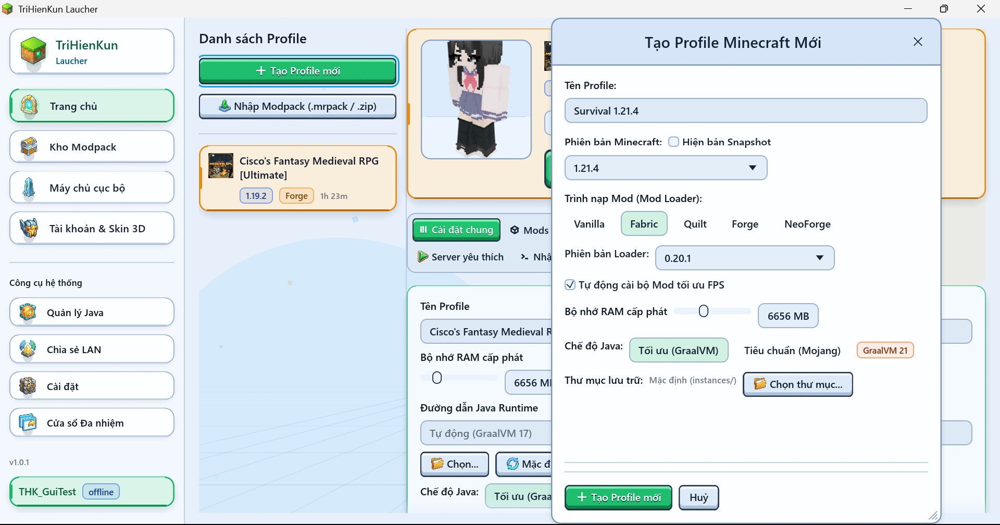
      <p align="center"><sub>Tạo Profile mới</sub></p>
    </td>
    <td width="50%" valign="top">
      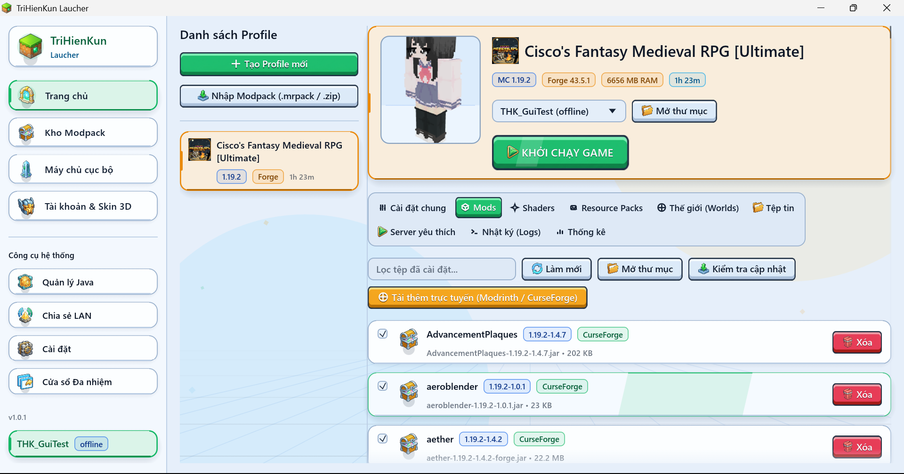
      <p align="center"><sub>Quản lý Mods</sub></p>
    </td>
  </tr>
  <tr>
    <td width="50%" valign="top">
      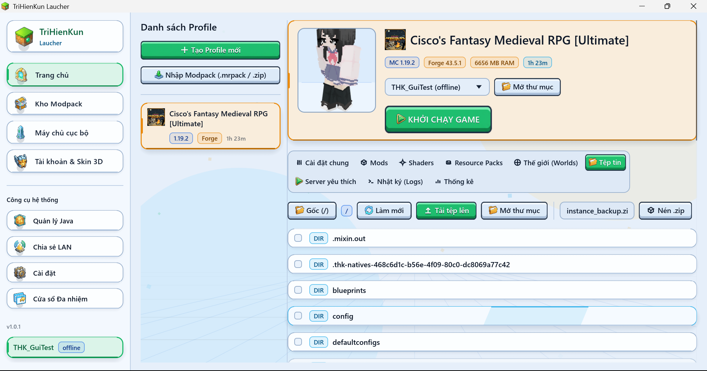
      <p align="center"><sub>Quản lý tệp tin</sub></p>
    </td>
    <td width="50%" valign="top">
      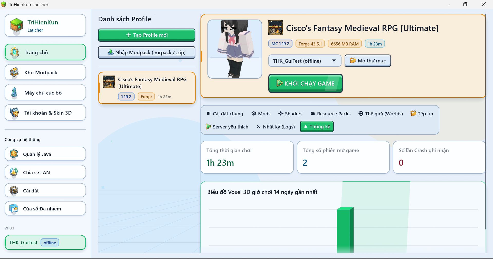
      <p align="center"><sub>Thống kê giờ chơi</sub></p>
    </td>
  </tr>
</table>

### Kho Modpack & Nội dung trực tuyến

<p align="center">
  
  <br />
  <sub>Kho Modpack trực tuyến</sub>
</p>

<table>
  <tr>
    <td width="50%" valign="top">
      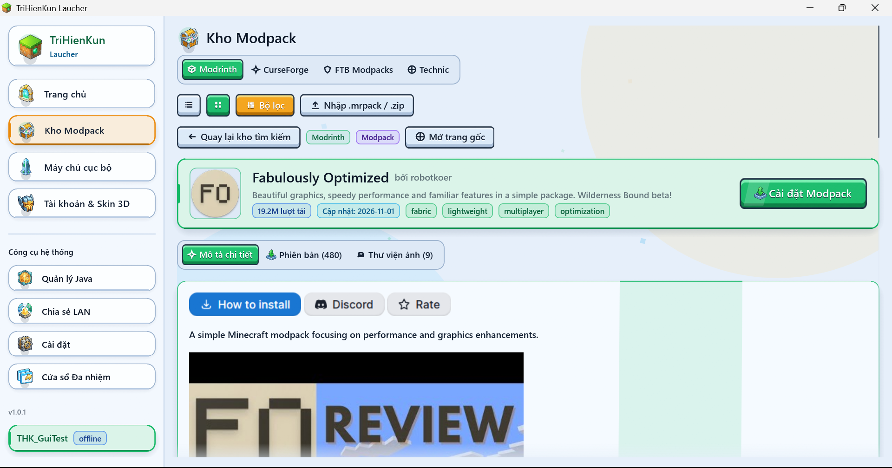
      <p align="center"><sub>Chi tiết gói &amp; phiên bản</sub></p>
    </td>
    <td width="50%" valign="top">
      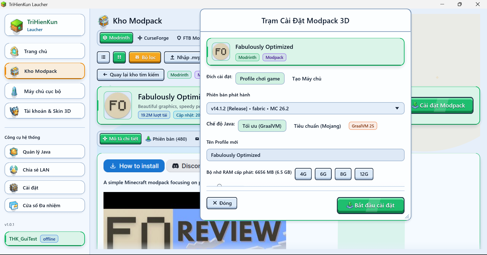
      <p align="center"><sub>Cài vào Profile hoặc tạo Máy chủ</sub></p>
    </td>
  </tr>
</table>

### Máy chủ cục bộ

<table>
  <tr>
    <td width="50%" valign="top">
      
      <p align="center"><sub>Bảng điều khiển Console</sub></p>
    </td>
    <td width="50%" valign="top">
      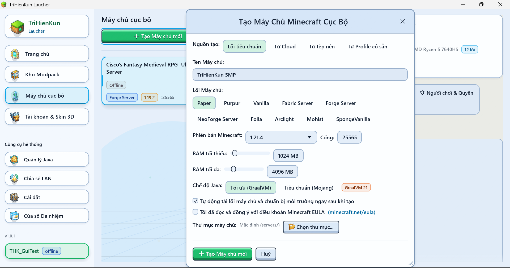
      <p align="center"><sub>Tạo máy chủ cục bộ</sub></p>
    </td>
  </tr>
  <tr>
    <td width="50%" valign="top">
      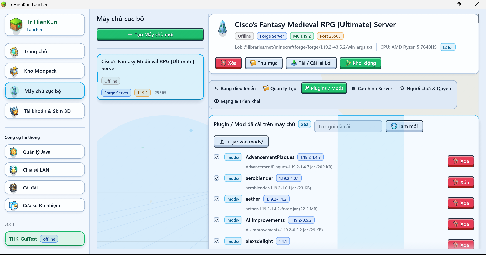
      <p align="center"><sub>Plugins &amp; Mods máy chủ</sub></p>
    </td>
    <td width="50%" valign="top">
      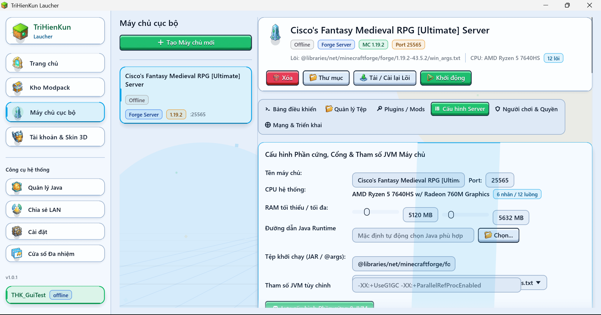
      <p align="center"><sub>Cấu hình &amp; server.properties</sub></p>
    </td>
  </tr>
  <tr>
    <td width="50%" valign="top">
      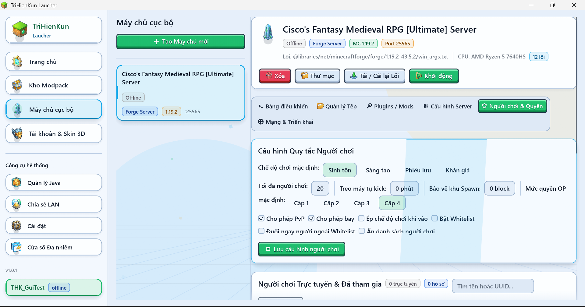
      <p align="center"><sub>Người chơi &amp; phân quyền</sub></p>
    </td>
    <td width="50%" valign="top">
      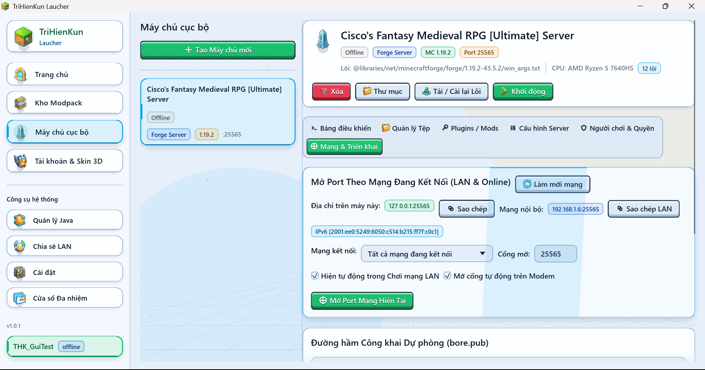
      <p align="center"><sub>Mở cổng mạng &amp; FTP/FTPS</sub></p>
    </td>
  </tr>
</table>

### Tài khoản, Công cụ hệ thống & Giao diện

<table>
  <tr>
    <td width="50%" valign="top">
      
      <p align="center"><sub>Tài khoản &amp; nhân vật 3D</sub></p>
    </td>
    <td width="50%" valign="top">
      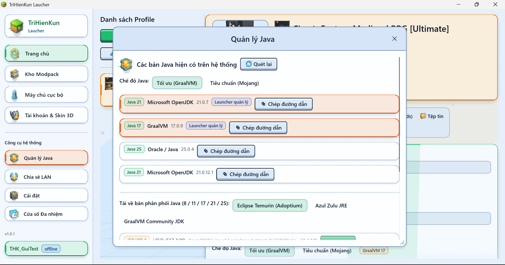
      <p align="center"><sub>Quản lý Java</sub></p>
    </td>
  </tr>
  <tr>
    <td width="50%" valign="top">
      
      <p align="center"><sub>Chia sẻ LAN &amp; mở cổng từ xa</sub></p>
    </td>
    <td width="50%" valign="top">
      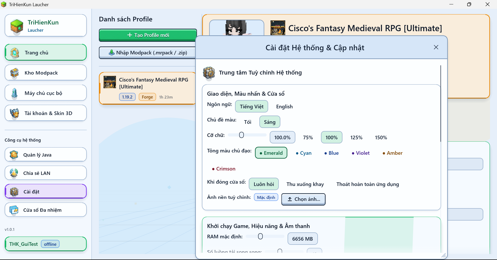
      <p align="center"><sub>Cài đặt hệ thống &amp; cập nhật</sub></p>
    </td>
  </tr>
</table>

<p align="center">
  
  <br />
  <sub>Chế độ tối</sub>
</p>

### Trên Android

<table>
  <tr>
    <td width="33%" valign="top">
      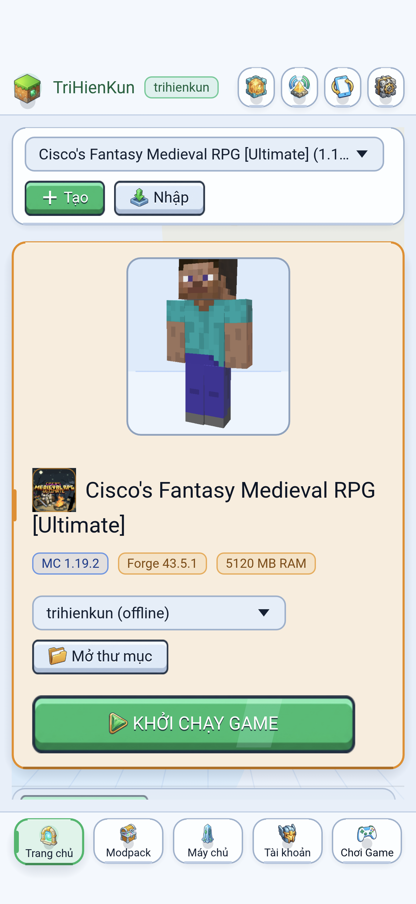
      <p align="center"><sub>Trang chủ</sub></p>
    </td>
    <td width="33%" valign="top">
      
      <p align="center"><sub>Kho Modpack</sub></p>
    </td>
    <td width="33%" valign="top">
      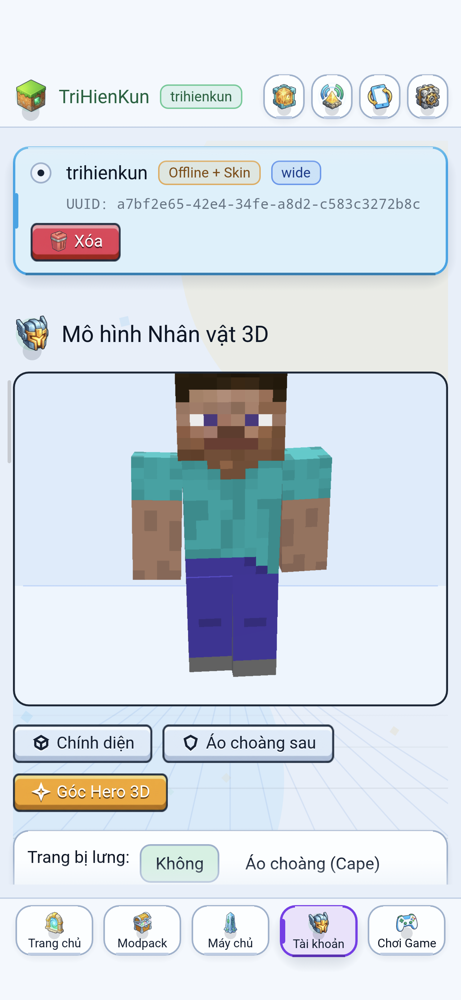
      <p align="center"><sub>Tài khoản &amp; Skin 3D</sub></p>
    </td>
  </tr>
</table>

<p align="center">
  
  <br />
  <sub>Chạy Forge 1.19.2 trực tiếp trên Android</sub>
</p>

<a id="tinh-nang"></a>

## Tính năng

- **Profile & Mod Loader**: Cài đặt và chạy song song Vanilla, Fabric, Quilt, Forge (`1.7.10` trở lên) và NeoForge; nhân bản Profile, đặt độ phân giải riêng, sửa tệp cấu hình, thống kê giờ chơi và gợi ý sửa lỗi khi game crash.
- **Kho nội dung 5 nguồn**: Tìm kiếm, tải về và cập nhật hàng loạt Modpack, Mod, Shader, Resource Pack và Plugin từ Modrinth, CurseForge, FTB Modpacks, Technic và Spiget, hoặc nhập gói `.mrpack` / `.zip` từ máy.
- **Tài khoản & nhân vật 3D**: Đăng nhập Microsoft OAuth2 (đồng bộ và đổi Skin/Cape trực tiếp với Mojang) hoặc dùng tài khoản Offline kèm máy chủ Yggdrasil cục bộ để hiển thị Skin, Cape và Elytra trong game.
- **Quản lý Java tự động**: Tự tải bản GraalVM hoặc Mojang JRE phù hợp với từng phiên bản Minecraft trên máy tính (hỗ trợ cài thêm Adoptium Temurin, Azul Zulu) và tự cài OpenJDK ARM64 trên Android.
- **Máy chủ cục bộ**: Khởi tạo 10 lõi máy chủ (Paper, Purpur, Folia, Vanilla, Fabric, Forge, NeoForge, Arclight, Mohist, SpongeVanilla) hoặc tạo máy chủ từ gói Modpack; theo dõi CPU, RAM, TPS/MSPT, Ping, chỉnh `server.properties`, phân quyền người chơi và đẩy dữ liệu qua FTP/FTPS.
- **Chia sẻ LAN & mở cổng mạng**: Phát quảng bá thế giới LAN trong mạng nội bộ hoặc VPN (Radmin VPN, Tailscale, ZeroTier), kết nối trực tiếp qua IPv6, mở cổng router bằng UPnP và tích hợp đường hầm dự phòng `bore.pub`.
- **Chơi trên Android**: Hỗ trợ xoay màn hình 4 chiều, tích hợp phím di chuyển kiểu Bedrock, chuột ảo tùy chỉnh bố cục, menu nổi bật/ẩn nhanh khi đang chơi và dịch vụ giữ kết nối mạng dưới nền.
- **Giao diện gốc đa nền tảng**: Hỗ trợ Tiếng Việt / Tiếng Anh, giao diện Sáng / Tối, tách nhiều cửa sổ làm việc trên máy tính, thu gọn xuống khay hệ thống, tự cập nhật có kiểm tra `SHA-256` và chế độ tiết kiệm RAM.

<a id="cau-truc-ma-nguon"></a>

## Cấu trúc mã nguồn

```text
trihienkun-laucher/
├── Cargo.toml                  # Cấu hình workspace (10 crates)
├── android/                    # Vỏ Android Activity/Service và tài nguyên đóng gói
├── scripts/                    # Kịch bản đóng gói APK arm64-v8a
├── assets/                     # Biểu tượng, đồ họa giao diện và ngôn ngữ vi/en
├── crates/
│   ├── thk-core/               # Đường dẫn dữ liệu, cơ sở dữ liệu, trình tải tệp, giải nén, đa ngôn ngữ
│   ├── thk-auth/               # Đăng nhập Microsoft OAuth2, Mojang Skin API, lưu khóa và Yggdrasil cục bộ
│   ├── thk-java/               # Quét và cài đặt GraalVM, Mojang JRE, Adoptium, Zulu, OpenJDK Android
│   ├── thk-mods/               # Kết nối 5 kho nội dung, cài đặt Modpack/Mod và kiểm tra cập nhật
│   ├── thk-launcher/           # Khởi chạy Vanilla + 4 Mod Loader, giám sát phiên game và phân tích lỗi
│   ├── thk-server/             # Cài đặt 10 lõi máy chủ, theo dõi tài nguyên, quản lý người chơi, FTP/FTPS
│   ├── thk-network/            # Mở cổng LAN / VPN / IPv6 / UPnP, Ping máy chủ, đường hầm Bore, Discord RPC
│   ├── thk-renderer3d/         # Kết xuất mô hình nhân vật 3D, Cape và Elytra
│   ├── thk-android-ffi/        # Cầu nối JNI/FFI gốc cho JVM và hệ thống Android
│   └── thk-app/                # Giao diện người dùng trên Desktop và Android, trình tự cập nhật
└── docs/                       # Tài liệu kỹ thuật và ảnh chụp màn hình
```

<a id="tu-bien-dich"></a>

## Tự biên dịch

Trên Debian hoặc Ubuntu, cài đặt các thư viện hệ thống trước khi biên dịch:

```bash
sudo apt-get update
sudo apt-get install -y pkg-config libasound2-dev libgtk-3-dev libayatana-appindicator3-dev \
  libxdo-dev libxcb-render0-dev libxcb-shape0-dev libxcb-xfixes0-dev libxkbcommon-dev libssl-dev
```

Chạy kiểm thử và biên dịch từ thư mục gốc dự án:

```bash
cargo test --workspace -- --test-threads=1
cargo build --release -p thk-app
powershell -NoProfile -ExecutionPolicy Bypass -File scripts/build-android-apk.ps1 -Profile release
```

## Thư mục dữ liệu

- **Windows**: `%APPDATA%\.TriHienKunLaucher`
- **Linux**: `~/.config/.TriHienKunLaucher`
- **macOS**: `~/Library/Application Support/.TriHienKunLaucher`
- **Android**: `/data/user/0/com.trihienkun.laucher/files/.TriHienKunLaucher`

<a id="tai-lieu"></a>

## Tài liệu

- [Hướng dẫn sử dụng](docs/USER_GUIDE.md)
- [Kiến trúc hệ thống](docs/ARCHITECTURE.md)
- [Cơ sở dữ liệu và lưu trữ khóa](docs/DATABASE_SCHEMA.md)
- [Mô hình bảo mật](docs/SECURITY.md)
- [Kiểm thử](docs/TESTING.md)
- [Hướng dẫn đóng góp](CONTRIBUTING.md)

## Giấy phép

Phát hành theo giấy phép [MIT](LICENSE). Bản quyền (c) 2026 TriHienKun.
