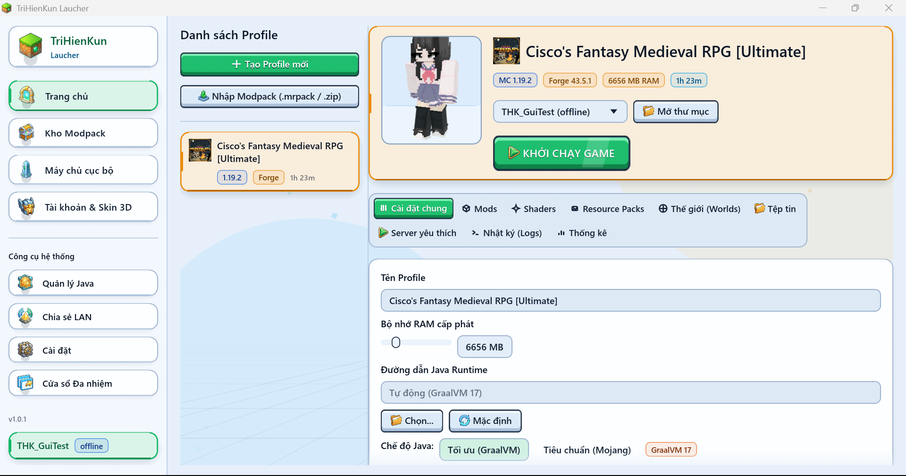
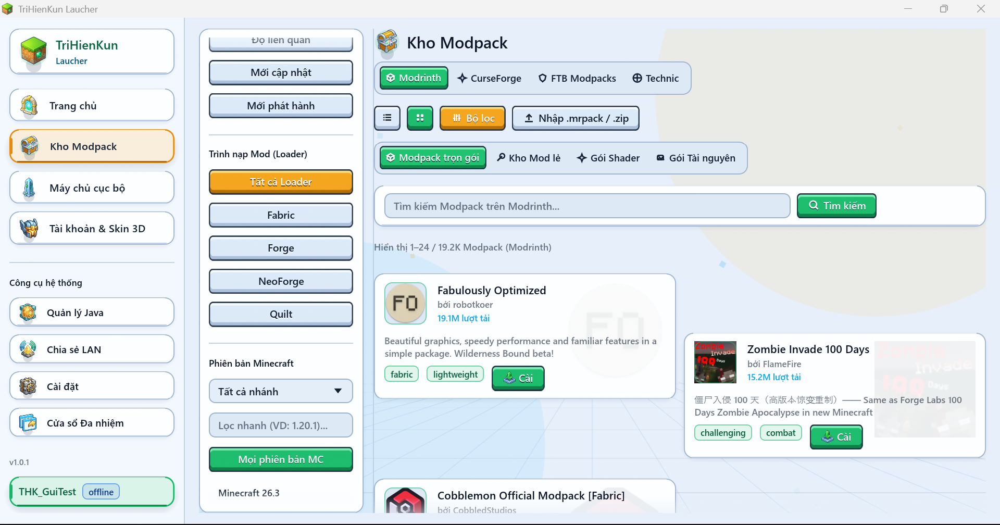
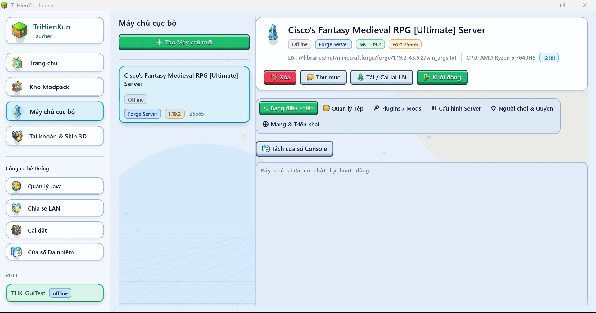
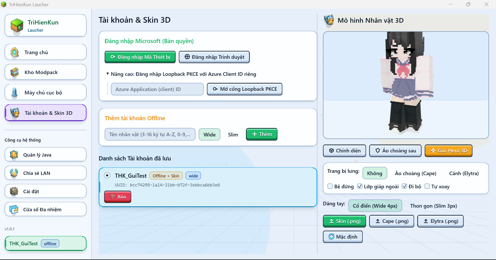
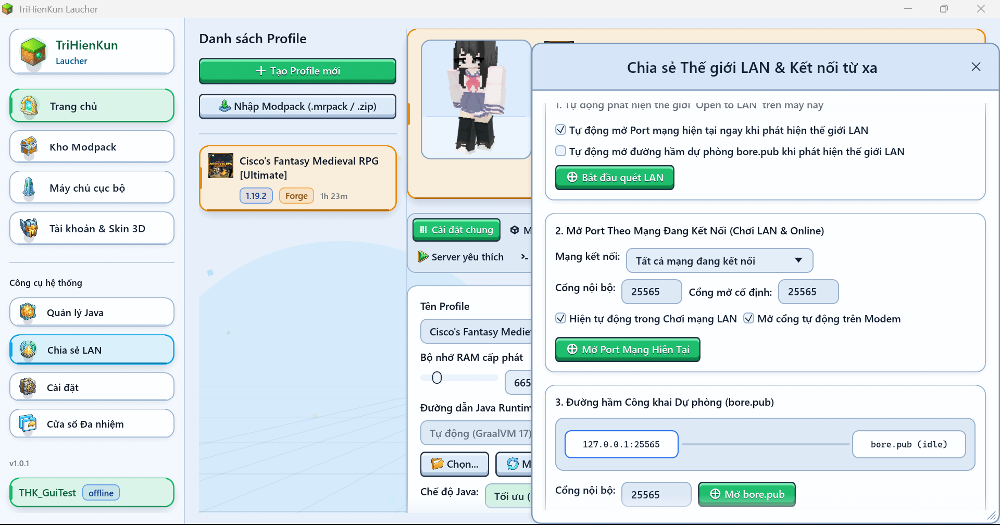
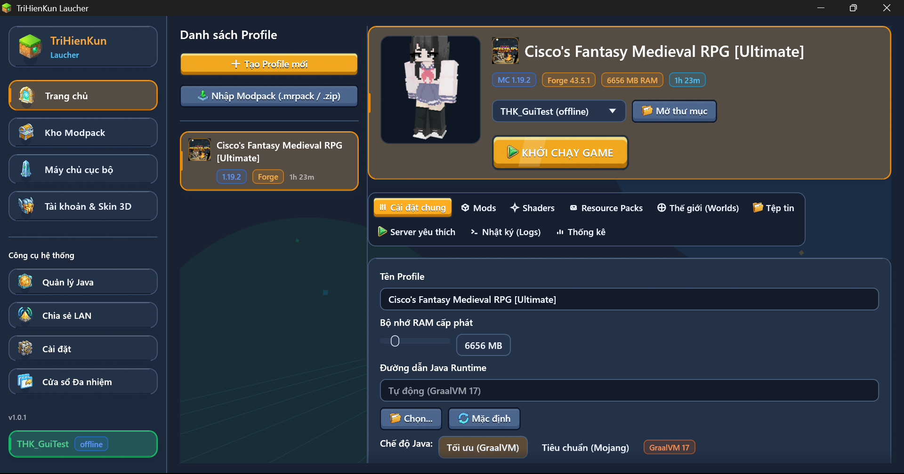
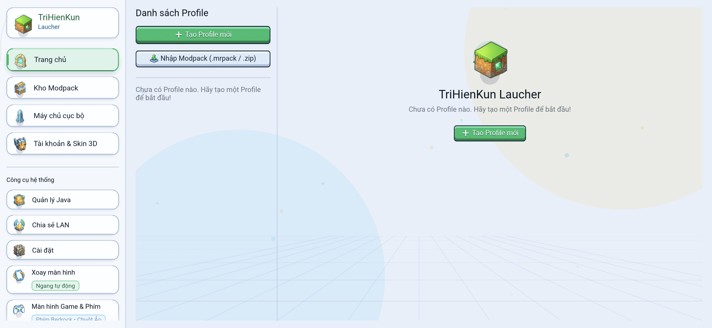
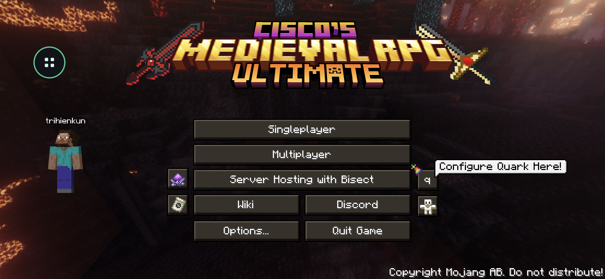
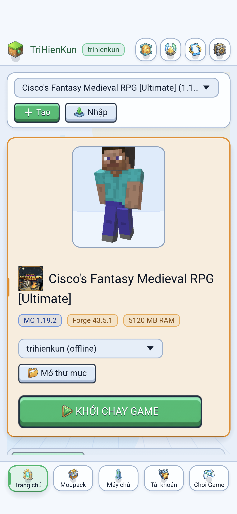

<div align="center">


# TriHienKun Laucher

Trình khởi chạy Minecraft, quản lý Modpack và vận hành máy chủ cục bộ viết bằng Rust cho Windows, Linux, macOS và Android.

[](https://github.com/PhamTriHien/TriHienKun_Laucher/actions/workflows/release.yml)
[](https://github.com/PhamTriHien/TriHienKun_Laucher/releases/latest)
[](Cargo.toml)
[](LICENSE)

<p>
  <a href="#hinh-anh-ung-dung">Hình ảnh</a> ·
  <a href="#tai-xuong">Tải xuống</a> ·
  <a href="#tinh-nang">Tính năng</a> ·
  <a href="#cau-truc-ma-nguon">Mã nguồn</a> ·
  <a href="#tu-bien-dich">Tự biên dịch</a> ·
  <a href="#tai-lieu">Tài liệu</a>
</p>

</div>

<a id="hinh-anh-ung-dung"></a>

## Hình ảnh ứng dụng

<p align="center">
  
  <br />
  <sub>Trang chủ quản lý Profile, xem trước nhân vật 3D và cấu hình Java trên Windows 11.</sub>
</p>

### Trên máy tính (Desktop)

<table>
  <tr>
    <td width="50%" valign="top">
      
      <p align="center"><sub>Kho Modpack trực tuyến (Modrinth, CurseForge, FTB, Technic)</sub></p>
    </td>
    <td width="50%" valign="top">
      
      <p align="center"><sub>Quản lý máy chủ cục bộ và bảng lệnh Console trực tiếp</sub></p>
    </td>
  </tr>
  <tr>
    <td width="50%" valign="top">
      
      <p align="center"><sub>Quản lý tài khoản và xem trước Skin, Cape, Elytra 3D</sub></p>
    </td>
    <td width="50%" valign="top">
      
      <p align="center"><sub>Chia sẻ mạng LAN, mở cổng Online (IPv6 / UPnP) và đường hầm Bore</sub></p>
    </td>
  </tr>
</table>

<p align="center">
  
  <br />
  <sub>Giao diện chế độ tối (Dark Mode) trên máy tính.</sub>
</p>

### Trên điện thoại Android

<table>
  <tr>
    <td width="50%" valign="top">
      
      <p align="center"><sub>Giao diện màn hình ngang trên Android</sub></p>
    </td>
    <td width="50%" valign="top">
      
      <p align="center"><sub>Chạy Modpack Forge 1.19.2 trực tiếp trên Android kèm nút điều khiển nổi tròn</sub></p>
    </td>
  </tr>
</table>

<p align="center">
  
  <br />
  <sub>Giao diện màn hình dọc tự căn lề tránh vùng khuyết camera và thanh điều hướng đáy.</sub>
</p>

<a id="tai-xuong"></a>

## Tải xuống

Tải gói cài đặt mới nhất tại trang [GitHub Releases](https://github.com/PhamTriHien/TriHienKun_Laucher/releases/latest):

| Nền tảng | Tệp phát hành | Ghi chú |
| :--- | :--- | :--- |
| Windows 10 / 11 (x64) | [`trihienkun-laucher-windows-x64.exe`](https://github.com/PhamTriHien/TriHienKun_Laucher/releases/latest/download/trihienkun-laucher-windows-x64.exe) | Bản Portable chạy ngay, không cần cài đặt. |
| Android 9.0+ (ARM64) | [`trihienkun-laucher-android-arm64.apk`](https://github.com/PhamTriHien/TriHienKun_Laucher/releases/latest/download/trihienkun-laucher-android-arm64.apk) | Gói `arm64-v8a` hỗ trợ trang nhớ `16 KB`, cài trực tiếp. |
| Linux (x64) | [`trihienkun-laucher-linux-x64`](https://github.com/PhamTriHien/TriHienKun_Laucher/releases/latest/download/trihienkun-laucher-linux-x64) | Cấp quyền thực thi bằng `chmod +x` trước khi mở. |
| Linux (ARM64) | [`trihienkun-laucher-linux-arm64`](https://github.com/PhamTriHien/TriHienKun_Laucher/releases/latest/download/trihienkun-laucher-linux-arm64) | Cấp quyền thực thi bằng `chmod +x` trước khi mở. |
| macOS (Apple Silicon) | [`trihienkun-laucher-macos-arm64`](https://github.com/PhamTriHien/TriHienKun_Laucher/releases/latest/download/trihienkun-laucher-macos-arm64) | Dành cho máy Mac chip M1 trở lên (`chmod +x`). |
| macOS (Intel x64) | [`trihienkun-laucher-macos-x64`](https://github.com/PhamTriHien/TriHienKun_Laucher/releases/latest/download/trihienkun-laucher-macos-x64) | Dành cho máy Mac chip Intel (`chmod +x`). |
| Mã băm kiểm chứng | [`SHA256SUMS.txt`](https://github.com/PhamTriHien/TriHienKun_Laucher/releases/latest/download/SHA256SUMS.txt) | Mã băm `SHA-256` của toàn bộ tệp phát hành. |

Ứng dụng có sẵn trình kiểm tra cập nhật từ GitHub Releases và đối chiếu mã băm `SHA-256` trước khi thay thế tệp thực thi.

<a id="tinh-nang"></a>

## Tính năng

- **Đa Profile và 4 Mod Loader**: Cài đặt và chạy đồng thời nhiều phiên bản Vanilla, Fabric, Quilt, Forge (`1.7.10` trở lên) và NeoForge. Hỗ trợ nhân bản Profile, đặt độ phân giải riêng, quản lý tệp, thống kê giờ chơi và gợi ý sửa lỗi khi game văng (crash).
- **Kho nội dung 5 nguồn**: Tìm kiếm, cài đặt và cập nhật hàng loạt Modpack, Mod, Shader, Resource Pack và Plugin từ Modrinth, CurseForge, FTB Modpacks, Technic và Spiget, hoặc nhập gói `.mrpack` / `.zip` có sẵn trên máy.
- **Tài khoản và nhân vật 3D**: Đăng nhập Microsoft OAuth2 (lưu khóa trong bộ nhớ bảo mật của hệ điều hành, đồng bộ và đổi Skin/Cape trực tiếp với Mojang) hoặc dùng tài khoản Offline kèm máy chủ Yggdrasil cục bộ để hiển thị Skin, Cape và Elytra trong game.
- **Tự động quản lý Java**: Tự tải bản GraalVM hoặc Mojang JRE tương ứng với từng phiên bản Minecraft trên máy tính (hỗ trợ tải thêm Adoptium Temurin, Azul Zulu), và tự cài OpenJDK ARM64 trên điện thoại Android.
- **Quản trị máy chủ cục bộ**: Khởi tạo 10 lõi máy chủ (Paper, Purpur, Folia, Vanilla, Fabric, Forge, NeoForge, Arclight, Mohist, SpongeVanilla) hoặc dựng máy chủ trực tiếp từ gói Modpack. Theo dõi CPU, RAM, TPS/MSPT, Ping, chỉnh `server.properties`, quản lý quyền người chơi và đẩy tệp lên Hosting qua FTP/FTPS.
- **Mở cổng mạng và chia sẻ LAN**: Phát quảng bá thế giới LAN trong cùng Wi-Fi hoặc mạng ảo (Radmin VPN, Tailscale, ZeroTier), kết nối thẳng qua IPv6, tự mở cổng router bằng UPnP hoặc tạo đường hầm dự phòng qua `bore.pub`.
- **Trải nghiệm trên Android**: Hỗ trợ xoay màn hình 4 chiều, căn lề tránh vùng khuyết camera, tích hợp phím di chuyển kiểu Bedrock, chuột ảo tùy chỉnh vị trí, nút điều khiển nổi tròn đè trên khung hình game và dịch vụ chạy ngầm giữ kết nối mạng khi tắt màn hình.
- **Gọn nhẹ, không dùng WebView**: Kết xuất trực tiếp trên GPU (`egui` + `wgpu`), hỗ trợ Tiếng Việt và Tiếng Anh, giao diện Sáng / Tối, mở nhiều cửa sổ độc lập trên Desktop, thu gọn xuống khay hệ thống và có chế độ tiết kiệm RAM khi đang chơi.

Một số luồng cần người dùng tự xác thực tài khoản hoặc chấp thuận điều khoản EULA khi chạy thực tế; xem chi tiết phạm vi đã kiểm chứng tại [`docs/TESTING.md`](docs/TESTING.md).

<a id="cau-truc-ma-nguon"></a>

## Cấu trúc mã nguồn

```text
trihienkun-laucher/
├── Cargo.toml                  # Cấu hình Cargo Workspace (9 crates)
├── android/                    # Mã nguồn đóng gói Android Native (Manifest, Java bridge, tài nguyên)
├── scripts/                    # Kịch bản đóng gói APK arm64-v8a căn chỉnh 16 KB
├── assets/                     # Biểu tượng ứng dụng, tài nguyên giao diện và từ điển vi/en
├── crates/
│   ├── thk-core/               # Đường dẫn dữ liệu, SQLite WAL, trình tải đa luồng, giải nén, đa ngôn ngữ
│   ├── thk-auth/               # Microsoft OAuth2 PKCE, Mojang Skin API, Keyring, Yggdrasil cục bộ
│   ├── thk-java/               # Quét và tự động tải GraalVM, Mojang JRE, Adoptium, Zulu, OpenJDK Android
│   ├── thk-mods/               # Kết nối 5 kho nội dung, cài đặt Modpack/Mod và kiểm tra cập nhật
│   ├── thk-launcher/           # Khởi chạy Vanilla + 4 Mod Loader, quản lý phiên game và phân tích lỗi
│   ├── thk-server/             # Cài đặt 10 lõi máy chủ, giám sát tài nguyên, quản lý người chơi, FTP/FTPS
│   ├── thk-network/            # Mở cổng LAN / VPN / IPv6 / UPnP, Ping máy chủ, đường hầm Bore, Discord RPC
│   ├── thk-renderer3d/         # Kết xuất mô hình nhân vật 3D, Cape và Elytra bằng wgpu
│   └── thk-app/                # Giao diện người dùng trên Desktop và Android, trình tự cập nhật
└── docs/                       # Tài liệu kiến trúc, cơ sở dữ liệu, bảo mật, hướng dẫn sử dụng và kiểm thử
```

<a id="tu-bien-dich"></a>

## Tự biên dịch

Yêu cầu cài sẵn bộ công cụ Rust `stable` mới nhất (`rustup`). Trên Ubuntu hoặc Debian Linux, cài thêm các gói thư viện hệ thống trước khi biên dịch:

```bash
sudo apt-get update
sudo apt-get install -y pkg-config libasound2-dev libgtk-3-dev libayatana-appindicator3-dev \
  libxdo-dev libxcb-render0-dev libxcb-shape0-dev libxcb-xfixes0-dev libxkbcommon-dev libssl-dev
```

Chạy kiểm thử và biên dịch bản Release từ thư mục gốc của dự án:

```bash
# Chạy bộ kiểm thử toàn workspace
cargo test --workspace -- --test-threads=1

# Biên dịch bản Release cho Desktop (kết quả nằm trong target/release/)
cargo build --release -p thk-app

# Đóng gói APK Android arm64-v8a (yêu cầu Android SDK, NDK r28 và JDK 17+)
powershell -NoProfile -ExecutionPolicy Bypass -File scripts/build-android-apk.ps1 -Profile release
```

## Thư mục lưu dữ liệu

- **Windows**: `%APPDATA%\.TriHienKunLaucher`
- **Linux**: `~/.config/.TriHienKunLaucher` (hoặc `$XDG_CONFIG_HOME/.TriHienKunLaucher`)
- **macOS**: `~/Library/Application Support/.TriHienKunLaucher`
- **Android**: `/data/user/0/com.trihienkun.laucher/files/.TriHienKunLaucher`

<a id="tai-lieu"></a>

## Tài liệu

- [Hướng dẫn sử dụng](docs/USER_GUIDE.md)
- [Kiến trúc hệ thống](docs/ARCHITECTURE.md)
- [Cơ sở dữ liệu và lưu trữ khóa](docs/DATABASE_SCHEMA.md)
- [Mô hình bảo mật](docs/SECURITY.md)
- [Kiểm thử và phạm vi xác minh](docs/TESTING.md)
- [Hướng dẫn đóng góp](CONTRIBUTING.md)

## Giấy phép

Phát hành theo giấy phép [MIT](LICENSE). Bản quyền (c) 2026 TriHienKun.
