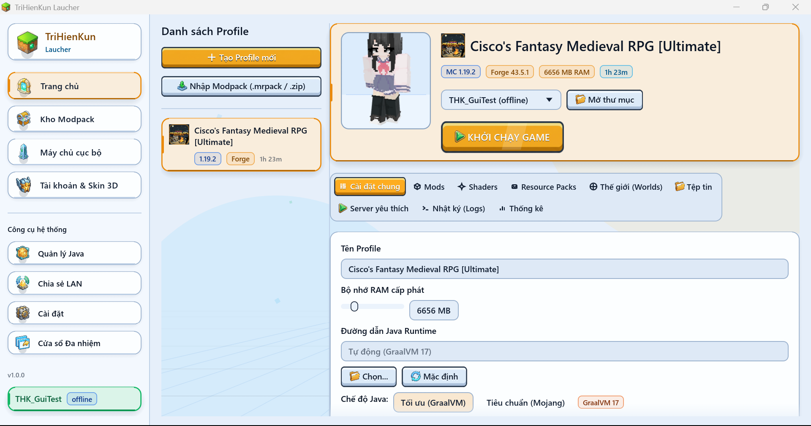
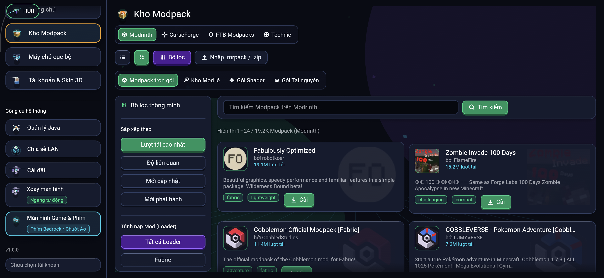
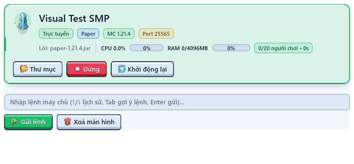
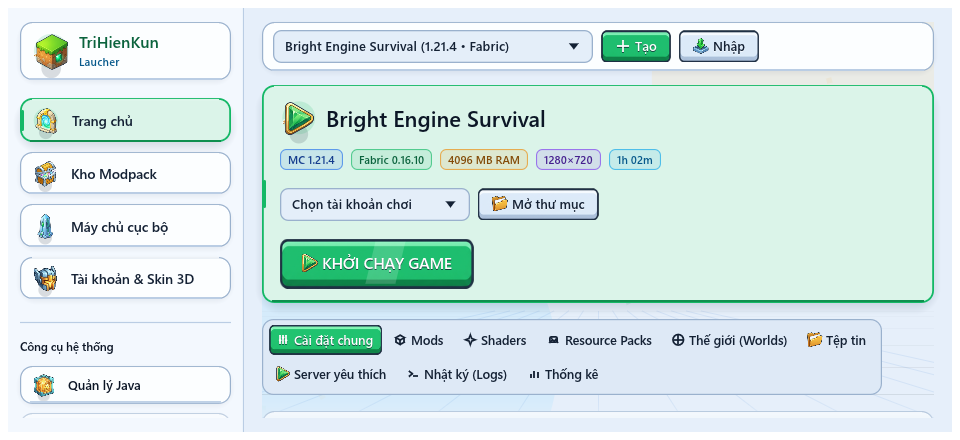
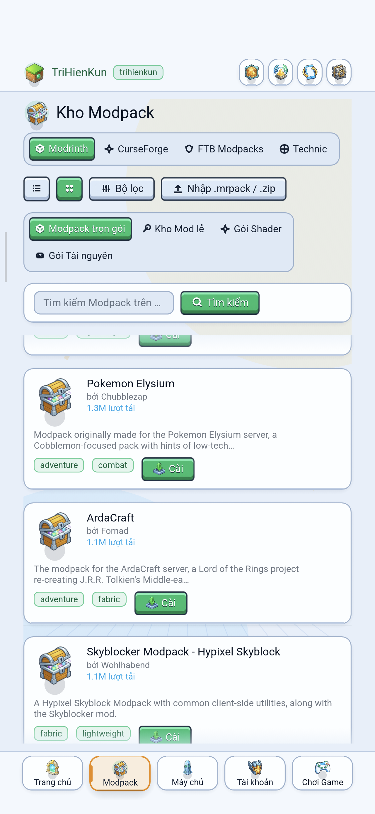
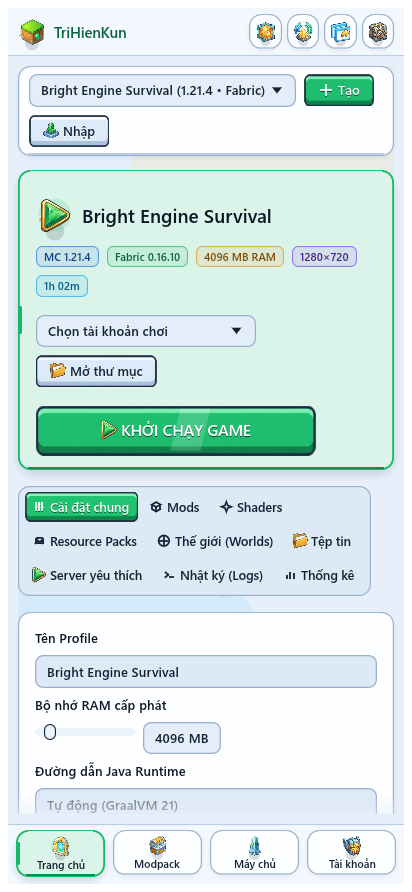
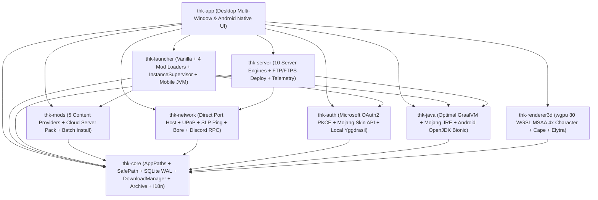

<div align="center">


# TriHienKun Laucher

**Trình khởi chạy, quản lý Modpack và vận hành máy chủ Minecraft viết bằng Pure Safe Rust**<br />
`eframe / egui 0.37` • `wgpu 30` • `tokio` • `rusqlite (WAL)` — Thực thi gốc trên **Desktop** (`Windows`, `Linux`, `macOS`) & **Android `arm64-v8a`** (căn chỉnh trang nhớ `16 KB`), không phụ thuộc Electron, Node.js, WebView hay máy chủ trung gian đóng kín.

[](https://github.com/PhamTriHien/TriHienKun_Laucher/actions/workflows/release.yml)
[](https://github.com/PhamTriHien/TriHienKun_Laucher/releases/latest)
[%5D-DEA584?logo=rust&logoColor=white)](Cargo.toml)
[](https://github.com/PhamTriHien/TriHienKun_Laucher/releases/latest)
[](LICENSE)

<p>
  <a href="#giao-dien">Giao diện thực tế</a> •
  <a href="#tai-xuong">Tải xuống</a> •
  <a href="#tinh-nang">8 Trụ cột tính năng</a> •
  <a href="#kien-truc">Kiến trúc 9 Crates</a> •
  <a href="#bien-dich">Biên dịch &amp; Đóng gói</a> •
  <a href="#du-lieu">Đường dẫn dữ liệu</a> •
  <a href="#kiem-dinh">Kiểm định chất lượng</a> •
  <a href="#tai-lieu">Tài liệu kỹ thuật</a>
</p>

</div>

---

<a id="giao-dien"></a>

## Triển Lãm Giao Diện Thực Tế

<div align="center">
  
  <p><em>Giao diện Desktop Windows 11 thực tế với chủ đề <strong>Engine Game Tươi Sáng (<code>ThemeMode::Light</code>)</strong>, khung kết xuất nhân vật 3D trực tiếp (<code>wgpu</code> MSAA 4x), Profile Modpack <code>Forge 43.5.1</code> (<code>MC 1.19.2</code>), 9 thẻ quản trị Profile và chế độ tự động phân giải <strong>Tối ưu (<code>GraalVM 17</code>)</strong>.</em></p>
</div>

<table>
  <tr>
    <td width="50%" valign="top">
      <h4 align="center">Kho Modpack &amp; Chủ Đề Tối Cobalt Dusk</h4>
      
      <p><sub>Duyệt trực tuyến kho <strong>Modrinth</strong> (cùng <strong>CurseForge</strong>, <strong>FTB</strong>, <strong>Technic</strong>) trên chủ đề <strong>Tối Cobalt Dusk</strong> (<code>2772×1280</code>), chuyển đổi Modpack / Mod lẻ / Shader / Resource Pack, cột bộ lọc thông minh theo Loader và nút nổi <code>HUB</code> ở góc trên trái.</sub></p>
    </td>
    <td width="50%" valign="top">
      <h4 align="center">Quản Trị Máy Chủ Trực Tuyến &amp; Console</h4>
      
      
      <p><sub>Bảng điều khiển máy chủ <code>Paper 1.21.4</code> trực tuyến với thanh đo <code>CPU / RAM</code>, cụm điều khiển <code>Thư mục / Dừng / Khởi động lại</code>, dòng lệnh Console hỗ trợ lịch sử <code>↑/↓</code> &amp; gợi ý <code>Tab</code>, cùng khung làm việc kiểm chuẩn <code>egui_kittest</code> (<code>0 failed pixels</code>).</sub></p>
    </td>
  </tr>
  <tr>
    <td width="50%" valign="top">
      <h4 align="center">Android Dọc (<code>SafeAreaInsets</code> &amp; Tự Xoay 4 Chiều)</h4>
      <p align="center">
        
        
      </p>
      <p><sub>Giao diện thực tế trên Android 17 màn hình dọc (<code>1280×2772</code>, tự xoay 4 chiều <code>fullSensor</code>), tự động bù lề <code>SafeAreaInsets</code> tránh phần khuyết camera đỉnh (<code>152px</code>) và thanh cử chỉ đáy, đi kèm thanh công cụ đỉnh gọn và thanh Dock 5 tab đáy (đối chiếu cùng ảnh kiểm chuẩn bố cục dọc).</sub></p>
    </td>
    <td width="50%" valign="top">
      <h4 align="center">Android Ngang (<code>Engine Game Tươi Sáng</code>)</h4>
      
      <p><sub>Giao diện Android 17 màn hình ngang (<code>2772×1280</code>) trên chủ đề <strong>Engine Game Tươi Sáng</strong> với nền lưới chân trời 3D, thanh điều hướng đầy đủ, thẻ chuyển nhanh <strong>Xoay màn hình</strong> và lối vào <strong>Màn hình Game &amp; Phím</strong> (<code>Phím Bedrock • Chuột Ảo</code>).</sub></p>
    </td>
  </tr>
</table>

---

<a id="tai-xuong"></a>

## Tải Xuống Bản Cài Đặt Đa Nền Tảng (`Releases`)

Các gói thực thi chính thức được biên dịch và đính kèm mã băm tại trang [**GitHub Releases**](https://github.com/PhamTriHien/TriHienKun_Laucher/releases/latest), khớp trực tiếp với bộ nhận diện nền tảng của trình tự cập nhật (`crates/thk-app/src/updater.rs`):

| Hệ điều hành & Kiến trúc | Tệp phát hành chính thức | Liên kết tải trực tiếp | Ghi chú triển khai |
| :--- | :--- | :--- | :--- |
| **Windows 10 / 11** (`x86_64`) | `trihienkun-laucher-windows-x64.exe` | [Tải `.exe`](https://github.com/PhamTriHien/TriHienKun_Laucher/releases/latest/download/trihienkun-laucher-windows-x64.exe) | Tệp thực thi gốc portable (`msvc`), nhúng sẵn biểu tượng `icon.ico` & siêu dữ liệu PE, không cần trình cài đặt phụ. |
| **Android 9 – 17** (`arm64-v8a`, `16 KB`) | `trihienkun-laucher-android-arm64.apk` | [Tải `.apk`](https://github.com/PhamTriHien/TriHienKun_Laucher/releases/latest/download/trihienkun-laucher-android-arm64.apk) | Gói cài đặt gốc `aarch64-linux-android`, căn chỉnh phân đoạn `PT_LOAD 16 KB` + `zipalign -P 16`, ký APK Signature v3 (cài trực tiếp sideload). |
| **Linux** (`x86_64`) | `trihienkun-laucher-linux-x64` | [Tải binary](https://github.com/PhamTriHien/TriHienKun_Laucher/releases/latest/download/trihienkun-laucher-linux-x64) | Biên dịch cho `x86_64-unknown-linux-gnu`; cấp quyền chạy `chmod +x trihienkun-laucher-linux-x64`. |
| **Linux** (`ARM64` / `aarch64`) | `trihienkun-laucher-linux-arm64` | [Tải binary](https://github.com/PhamTriHien/TriHienKun_Laucher/releases/latest/download/trihienkun-laucher-linux-arm64) | Biên dịch cho `aarch64-unknown-linux-gnu`; cấp quyền chạy `chmod +x trihienkun-laucher-linux-arm64`. |
| **macOS Apple Silicon** (`M1–M4` / `aarch64`) | `trihienkun-laucher-macos-arm64` | [Tải binary](https://github.com/PhamTriHien/TriHienKun_Laucher/releases/latest/download/trihienkun-laucher-macos-arm64) | Biên dịch cho `aarch64-apple-darwin`; cấp quyền chạy `chmod +x trihienkun-laucher-macos-arm64`. |
| **macOS Intel** (`x86_64`) | `trihienkun-laucher-macos-x64` | [Tải binary](https://github.com/PhamTriHien/TriHienKun_Laucher/releases/latest/download/trihienkun-laucher-macos-x64) | Biên dịch cho `x86_64-apple-darwin`; cấp quyền chạy `chmod +x trihienkun-laucher-macos-x64`. |
| **Bảng mã băm kiểm chứng** | `SHA256SUMS.txt` | [Tải `SHA256SUMS.txt`](https://github.com/PhamTriHien/TriHienKun_Laucher/releases/latest/download/SHA256SUMS.txt) | Danh sách mã băm `SHA-256` tổng hợp cho toàn bộ gói phát hành trong phiên bản tương ứng. |

### Kiểm tra tính toàn vẹn `SHA-256` & Cơ chế tự cập nhật trong ứng dụng

```powershell
# Trên Windows PowerShell: đối chiếu mã băm tệp vừa tải với SHA256SUMS.txt
Get-FileHash .\trihienkun-laucher-windows-x64.exe -Algorithm SHA256
Get-Content .\SHA256SUMS.txt
```

```bash
# Trên Linux / macOS: tự động kiểm chứng tệp thực thi đã tải trong cùng thư mục với SHA256SUMS.txt
sha256sum -c SHA256SUMS.txt --ignore-missing   # hoặc: shasum -a 256 -c SHA256SUMS.txt --ignore-missing
```

- **Tự cập nhật có xác thực mã băm (`updater.rs`)**: Ứng dụng truy vấn `releases?per_page=20` (chỉ nhận bản chính thức `!draft && !prerelease`), đối chiếu SemVer, chọn đúng tệp theo `(OS, ARCH)` và **bắt buộc** xác minh `SHA-256` từ trường `digest` hoặc `SHA256SUMS.txt` trước khi cho phép áp dụng (từ chối tải nếu bản phát hành thiếu mã băm). Trên Windows portable, helper `apply_update.ps1` dùng khóa độc quyền `.<exe>.update-lock`, kiểm tra lại `SHA-256` tệp staging và thay thế qua `System.IO.File.Replace` có giữ `.backup` / `.failed`; trên Linux và macOS, ứng dụng cấp quyền `0o755`, kiểm lại `SHA-256` tệp `.staged` rồi `rename` nguyên tử.
- **Lưu ý bảo mật & trạng thái kho phát hành**: `SHA-256` xác minh tính toàn vẹn đối với metadata trên GitHub Release, không thay thế chữ ký số của nhà phát hành (Code Signing). Khi kho lưu trữ hợp lệ chưa đăng tải bản Release nào, ứng dụng trả trạng thái `NoPublishedReleases` rõ ràng thay vì báo lỗi `HTTP 404`, đồng thời giữ nguyên cảnh báo thực nếu mất mạng hoặc sai tên kho.

---

<a id="tinh-nang"></a>

## 8 Trụ Cột Tính Năng Chuyên Sâu

### 1.  Giao Diện Gaming 3D Thời Gian Thực, Studio Nhân Vật & Đa Cửa Sổ (`thk-renderer3d` + `fx3d`)
- **9 crates Pure Safe Rust (`#![deny(unsafe_code)]`)**: Toàn bộ giao diện, hộp thoại và menu Khay hệ thống (`System Tray`) hỗ trợ chuyển đổi tức thì **Tiếng Việt / Tiếng Anh** (được kiểm chứng đồng bộ khóa ngôn ngữ 100% qua bài test tự động). Chỉ thị `#![deny(unsafe_code)]` ràng buộc mã nguồn trong workspace (chỉ miễn trừ chữ ký điểm vào `android_main` không chứa khối `unsafe`), không phải cam kết loại trừ `unsafe` bên trong các thư viện phụ thuộc.
- **Phòng Studio Nhân vật 3D (`wgpu 30.0.1` WGSL)**: Kết xuất khử răng cưa **MSAA 4x** hai lượt bằng cặp shader `SKIN_SHADER_WGSL` + `STAGE_SHADER_WGSL` (`cutout_pipeline` ghi chiều sâu + `translucent_pipeline` trộn alpha kèm định hướng pháp tuyến `@builtin(front_facing)`, tự giải phóng đích GPU offscreen khi thu gọn/ẩn cửa sổ); tự động trích xuất **Skin Steve `64×64` nguyên bản** từ `client.jar` đã cài (`extract_vanilla_steve_skin`), tự nhận diện khung tay `Wide 4px` / `Slim 3px` (`detect_skin_variant`), hỗ trợ `Cape` / `Elytra` đối xứng (mặc định tắt khi tài khoản chưa gắn áo choàng) và kéo-thả trực tiếp tệp `.png` vào khung 3D.
- **Chủ đề Engine Game Tươi Sáng, Đế Nút 9-Slice & Đa Cửa Sổ OS Gốc**: Mặc định giao diện **Engine Game Tươi Sáng (`ThemeMode::Light`, di trú 1 lần qua `ui_bright_engine_v1`)** kèm tùy chọn **Tối (`ThemeMode::Dark` Cobalt Dusk)** và 6 bảng màu chủ đạo (`Emerald`, `Cyan`, `Blue`, `Violet`, `Amber`, `Crimson`); nhúng sẵn 22 tài sản đồ họa RGBA (`assets/ui/*.png`, `307.612` byte: 6 đế nút 9-slice + 16 biểu tượng Voxel 3D) kết hợp chiếu phối cảnh tứ giác `glam::Mat3`, khối Voxel quỹ đạo `glam::Mat4`, thẻ vát bậc `gaming_card_3d`, thanh tab trượt `sliding_pill_tabs` và biểu đồ cột Voxel Isometric 3D. Hỗ trợ **Đa cửa sổ Desktop gốc** (`Cửa sổ Đa nhiệm`, `Tách cửa sổ Nhật ký`, `Tách cửa sổ Console` qua `show_viewport_immediate`), kéo giãn trực tiếp mọi thanh bên & 4 cạnh/4 góc hộp thoại (`resize_grab_radius_side = 8.5`, `corner = 10.0`), bố cục đáp ứng Dọc/Ngang và **cỡ chữ tự do `50.0% – 200.0%`** (bước `0.1%`). Tốc độ khung hình phụ thuộc phần cứng thực tế, không giả định mức 60 FPS cố định trên mọi thiết bị.

### 2.  Đa Profile Độc Lập, 4 Mod Loaders & Trình Quản Lý Tệp An Toàn (`thk-launcher`)
- **Vanilla & 4 Mod Loaders**: Cài đặt và hợp nhất thư viện Maven khử trùng lặp theo `(group, artifact, classifier)` cho **Vanilla**, **Fabric** (tùy chọn tự động tải bộ tối ưu *Sodium, Lithium, FerriteCore, EntityCulling, ModMenu*), **Quilt**, **Forge** (hỗ trợ cả Legacy `1.7.10–1.12.2`, `ForgeWrapper` `1.13–1.20.2` và Modern `ForgeBootstrap` `1.20.3–1.21.4+`) và **NeoForge** (bao gồm định dạng phiên bản `26.x`).
- **Giám sát đa phiên (`InstanceSupervisor`)**: Định danh theo khóa kép `InstanceKey { profile_id, account_id }` để chạy song song nhiều tài khoản/phiên bản với thư mục `natives` cô lập riêng từng phiên, nối `CancellationToken` xuyên suốt giai đoạn chuẩn bị tải tệp, tùy chỉnh **độ phân giải cửa sổ riêng (`window_width × window_height`)** hoặc **Toàn màn hình (`--fullscreen`)**, ưu tiên GPU rời DirectX + `ABOVE_NORMAL_PRIORITY_CLASS` trên Windows, **Nhân bản Profile** bất đồng bộ (`spawn_blocking`), vào thẳng máy chủ qua `QuickPlay` và thống kê giờ chơi 14 ngày gần nhất trên **SQLite WAL**.
- **Trình quản lý tệp & Chẩn đoán sự cố**: Duyệt cây thư mục Profile qua lớp bảo vệ chống thoát đường dẫn `SafePath`, sửa trực tiếp tệp cấu hình (`.toml`, `.json`, `.json5`, `.cfg`, `.properties`, `.txt`), nén/giải nén `.zip` chống Zip-Slip và phân tích báo cáo lỗi qua `CrashAnalyzer` kèm nút tải Mod thiếu hoặc nâng cấp Mod Loader 1 chạm.

### 3.  Microsoft OAuth2 PKCE, Đồng Bộ Mojang Skin/Cape & Máy Chủ Yggdrasil Cục Bộ (`thk-auth`)
- **Microsoft OAuth2 trực tiếp & OS Keyring**: Hỗ trợ đăng nhập bằng **Mã Thiết Bị (`microsoft.com/link`)**, **Desktop Redirect PKCE `S256`** và **Loopback PKCE với Azure Client ID riêng** (lưu riêng `oauth_client_id` cho từng tài khoản, bắt buộc khớp tham số `state`, từ chối callback lạ mà không làm mất phiên chờ và đóng cổng qua `child_token` + `drop_guard`). Token nhạy cảm được tách cặp khóa `:mc` / `:ms` trong **OS Keyring** trên Desktop (hoặc tệp `.credentials/*.sec` quyền `0o600` theo UID ứng dụng trên Android), tự động đồng bộ **Skin + Active Cape** từ Mojang Cloud, tải Skin `.png` mới (kể cả ảnh HD `128×128+` hoặc cổ điển `64×32`, tự chuẩn hóa premultiplied-alpha `64×64`) lên Mojang API và khôi phục Skin mặc định.
- **Offline UUID v3 & Máy chủ HTTP Yggdrasil nội bộ**: Tự động khởi chạy máy chủ Yggdrasil cục bộ bằng `axum` trên `127.0.0.1:0` khi vào game Offline có gắn Skin / Cape / Elytra tùy chỉnh, kiểm chứng `AUTHLIB_INJECTOR_SHA256`, truyền `-Dauthlibinjector.yggdrasil.prefetched`, ký `SHA1withRSA` cho Minecraft `1.19+–1.21+`, định danh URL texture theo mã băm `SHA-256` không tham số truy vấn, thu chuẩn ảnh HD về `64×64` cho `HttpTexture` trong game (vẫn giữ bản HD sắc nét trên khung Studio 3D) và phục vụ điểm cuối tra cứu hồ sơ `/api/users/profiles/minecraft/{username}` & `/api/profiles/minecraft` tương thích các mod giao diện như `FancyMenu`.

### 4.  Tự Động Tối Ưu GraalVM JDK, Mojang JRE & Android OpenJDK Bionic (`thk-java`)
- **Chế độ Java Tối ưu mặc định (`JavaRuntimeMode::OptimalGraalVm`)**: Tự động suy luận chuẩn Java theo manifest hoặc thế hệ Minecraft: trên Desktop tự động tải, đối chiếu `SHA-256` qua vùng staging và kích hoạt **GraalVM Community JDK** (`GraalVM 17` cho `MC 1.17–1.20.4`, `GraalVM 21` cho `MC 1.20.5–1.21.x`, `GraalVM 25` cho `MC 26.x`), bảo toàn **`Java 8` (`jre-legacy`)** tương thích cho `MC <= 1.16.5` và tự dự phòng sang Mojang JRE chính thức khi cần.
- **Android OpenJDK Bionic ARM64 + `libthk_jvm_shim.so`**: Trên Android `arm64-v8a` (`aarch64` Bionic), Launcher tự động tải, kiểm chứng `SHA-256` và giải nén thuần Rust (`.tar.xz` qua `lzma-rust2`) các bản **OpenJDK Bionic ARM64 (`Java 8 / 17 / 21 / 25`)**, cấu hình `LD_LIBRARY_PATH` và nạp shim `libthk_jvm_shim.so` (`M_BIONIC_SET_HEAP_TAGGING_LEVEL = 0` qua `LD_PRELOAD`) để thực thi trực tiếp cả trình cài đặt headless (`forge/neoforge --installServer`) lẫn **Dedicated Server cục bộ** ngay trên điện thoại.
- **Chuyển đổi linh hoạt & Cài đặt thủ công**: Cho phép chuyển 1 chạm giữa **Tối ưu (GraalVM)** và **Tiêu chuẩn (Mojang)** (`jre-legacy`, `alpha`, `gamma`, `delta`, `epsilon`), kiểm tra hậu nghiệm `major_version` cho đường dẫn `java_path` riêng của cả Profile lẫn Máy chủ, và tải thủ công các bản phân phối từ **Eclipse Temurin (Adoptium)**, **Azul Zulu**, **GraalVM Community** hoặc **OpenJDK ARM64**.

### 5.  Kho Nội Dung 5 Nguồn, Cài Đặt Giao Dịch Hardlink & Phân Giải 16 Luồng (`thk-mods`)
- **5 nền tảng nội dung trực tuyến**: Tìm kiếm phân trang, lọc theo Loader / phiên bản / lượt tải, xem mô tả Markdown, phóng to ảnh **Lightbox** và cài đặt trực tiếp Modpack, Mod, Shader, ResourcePack, Plugin từ **Modrinth**, **CurseForge**, **FTB Modpacks**, **Technic Platform (+ Solder)** và **Spiget**, kèm trích xuất phiên bản chuẩn (`extract_canonical_version_number`).
- **Kiểm tra & cập nhật hàng loạt ưu tiên `Release`**: Quét phiên bản mới đồng loạt qua `POST /v2/version_files/update` (Modrinth) và đối chiếu vân tay **Murmur2** `/v1/fingerprints/432` (CurseForge) kèm nút **Cập nhật 1 chạm / Cập nhật tất cả** mà vẫn giữ nguyên trạng thái bật/tắt (`.disabled`) của từng gói.
- **Giao dịch staging, liên kết cứng `fs::hard_link` & Hủy giải nén có phối hợp**: Gói lẻ cài theo lô vào `.thk-install-<UUID>` và ghi metadata bằng giao dịch SQLite `commit_installed_content`; gói Modpack (từ 4 kho Cloud hoặc nhập `.mrpack` / `.zip` từ đĩa) chuẩn bị trong `.thk-pack-<UUID>/payload`, phân giải manifest CurseForge hàng loạt qua `POST /v1/mods/files` kết hợp **16 luồng đồng thời (`buffer_unordered(16)`)** có báo tiến trình từng tệp, kiểm tra `CancellationToken` theo từng khối giải nén `64 KiB`, ưu tiên liên kết cứng cùng ổ đĩa (`fs::hard_link` kèm dự phòng `create_new`), từ chối bỏ qua tệp bắt buộc lỗi và lưu nguyên tử Profile + `installed_content` vào SQLite. Nếu rollback gặp khóa tệp từ hệ điều hành, ứng dụng giữ nguyên payload cùng `recovery.json` (hiển thị trong **Cài đặt → Bộ nhớ đệm**) để đối chiếu an toàn; lưu ý đây là rollback trong tiến trình, chưa phải giao dịch crash-atomic khi mất điện đột ngột.

### 6.  Quản Trị 10 Lõi Máy Chủ, Cloud Modpack Server, FTP/FTPS & Telemetry Thực (`thk-server`)
- **4 chế độ khởi tạo máy chủ**:
  1. Cài đặt tự động **10 lõi tiêu chuẩn**: `Paper` & `Folia` (qua Fill v3 chọn build `STABLE` mới nhất, kiểm kích thước & `SHA-256`), `Purpur`, `Vanilla`, `Fabric`, `Forge`, `NeoForge`, `Arclight`, `Mohist`, `SpongeVanilla`.
  2. **Tạo trực tiếp từ 4 kho Cloud Modpack** (`Modrinth`, `CurseForge` ưu tiên `serverPackFileId`, `FTB`, `Technic`) ngay trong hộp thoại Tạo Máy chủ hoặc từ Trạm Cài đặt Modpack.
  3. **Nhập từ tệp nén Modpack trên đĩa** (`.mrpack`, CurseForge `.zip` hoặc gói Dedicated Server `.zip`), tự lọc bỏ các mod/thư mục chỉ dành cho Client.
  4. **Nhân bản từ Profile có sẵn** (`mods/`, `config/`, `defaultconfigs/`, `kubejs/`, `scripts/`, `datapacks/`) và cài tự động runtime máy chủ tương ứng.
- **Bảng điều khiển, Telemetry thực & Quản trị người chơi**: Yêu cầu chủ máy chủ xác nhận tường minh Minecraft EULA trước khi chạy, kiểm tra xung đột cổng TCP & `major_version` Java trước khi mở JVM, tắt JLine trên ống dẫn ẩn, lọc mã điều khiển ANSI/NUL chống chèn đa lệnh (`sanitize_console_command`), hỗ trợ gợi ý `Tab` & lịch sử lệnh `↑ / ↓`, đo thời gian thực **`CPU %` / `Số lõi đang dùng` / `RAM MB` / `TPS` / `MSPT` / `Ping nội bộ & công khai` / `Uptime`** trên cả Windows, Linux, macOS và Android (đọc `/proc/<pid>/stat` vượt rào SELinux chặn `/proc/stat` trên Android 12–17), chỉnh trực quan `server.properties` và quản lý đầy đủ `ops.json`, `whitelist.json`, `banned-players.json`, `banned-ips.json` cùng hồ sơ `.dat`.
- **Triển khai lên Hosting qua FTP / Explicit FTPS (`ftp_deploy`)**: Đẩy luồng nhị phân từng khối `64 KiB` có hỗ trợ hủy lên Hosting từ xa qua FTP hoặc Explicit FTPS (`AUTH TLS` / `PROT P` xác thực chứng chỉ `webpki-roots` bằng `rustls`), tách biệt mật khẩu trong **OS Keyring** (`server-ftp:<id>`).

### 7.  Mở Port Trực Tiếp (LAN / VPN / IPv6 Online / UPnP), Ping SRV & Bore (`thk-network`)
- **Mở Port theo mạng đang kết nối (`direct_host.rs`)**: Tự động nhận diện các giao diện mạng đang hoạt động trên Desktop (`sysinfo::Networks` + tuyến mặc định UDP) và Android (`.thk_bridge/networks.json` + `WifiManager.MulticastLock`), mở cầu nối TCP hai chiều (`0.0.0.0:<port>` + `[::]:<port>` `IPV6_V6ONLY` với `TCP_NODELAY`) cho cả **Máy chủ cục bộ** lẫn thế giới **Open to LAN**, phát quảng bá LAN Multicast `224.0.2.60:4445` mỗi `1.5s` (có chống tự lặp `self_hosted_lan_port`) để người chơi cùng Wi-Fi / LAN / Hotspot / Radmin VPN / Tailscale / ZeroTier thấy ngay trong màn hình *Multiplayer*.
- **Kết nối Online trực tiếp IPv6 & Mở cổng Modem UPnP IGD**: Cung cấp địa chỉ **Global Unicast IPv6 (`[<ipv6>]:<port>`, `2000::/3`)** kết nối thẳng ngang hàng không qua máy chủ trung gian nước ngoài; tự động ánh xạ cổng trên Router qua **UPnP IGD** (`SSDP 239.255.255.250:1900` + `SOAP AddPortMapping` / `DeletePortMapping`, chỉ gọi tới gateway IPv4 nội bộ chống SSRF) kèm phát hiện trung thực lớp mạng `CGNAT` (`100.64.0.0/10`).
- **Quét LAN an toàn, Ping DNS SRV & Đường hầm dự phòng Bore**: Lắng nghe `Open to LAN` có xác minh IP nguồn thuộc card mạng của chính máy cục bộ (`is_local_interface_ipv4`, chặn gói giả mạo từ máy khác trong Wi-Fi công cộng), thực thi giao thức Minecraft Server List Ping hỗ trợ IPv6 + phân giải `SRV` (`hickory-resolver`) + màu MOTD hex `§x`, và nhúng trực tiếp thư viện thuần Rust `bore-cli` làm đường hầm dự phòng `bore.pub:<port>`.

### 8.  Chơi Game Cảm Ứng Bedrock, Menu Nổi `HUB`, `ThkKeepAliveService` &  Siêu Tiết Kiệm RAM
- **Màn hình Run Game cảm ứng trên Android (`mobile_game.rs` + `mobile_jvm.rs`)**: Tích hợp cụm **Phím di chuyển kiểu Bedrock 3×3** vẽ vector thủ tục (hỗ trợ đi chéo & lén), hàng phím hành động đa chạm tùy chỉnh, **Chuột Ảo (`Virtual Mouse`)** đa chế độ (con trỏ kho đồ/menu + bàn rê xoay góc nhìn 360° + thanh nút chuột), trình **Chỉnh sửa Bố cục Phím (`Edit Phím`)** kéo-thả trực tiếp lưu nguyên tử vào `mobile_controls.json`, lựa chọn bộ kết xuất OpenGL (**Holy-GL4ES** hoặc **MobileGlues** trên tiến trình `:game` `GameJvmService` kèm `mobile_runtime_arm64.zip`) và tỷ lệ kết xuất `40% – 100%`.
- **Menu Nổi `HUB`, Vùng an toàn `SafeAreaInsets` & Tự xoay 4 chiều**: Nút nổi **`HUB`** cho phép bật/ẩn tức thì toàn bộ giao diện quản trị Launcher đè trực tiếp lên khung hình game đang chạy (`wgpu` GLES `ALPHA_SIZE = 8` + `PixelFormat.TRANSLUCENT` trên `SurfaceView`); tự động đọc `DisplayCutout`, `WindowInsets` và góc bo `RoundedCorner` sang `SafeAreaInsets` để kẹp biên an toàn mọi thanh công cụ, hộp thoại, phím cảm ứng và nút `HUB`, kết hợp **6 chế độ xoay màn hình** (mặc định **Tự xoay tự do `FullSensor` 4 chiều**).
- **Duy trì kết nối chạy ngầm (`ThkKeepAliveService`) & Chế độ Siêu tiết kiệm RAM (`low_ram_mode`)**: Dịch vụ tiền cảnh Android giữ đồng thời `PARTIAL_WAKE_LOCK` + `WIFI_MODE_FULL_LOW_LATENCY` + `MulticastLock` để không ngắt mạng Server / Mở Port / Phiên game khi tắt màn hình hoặc thu nhỏ (kèm nút nổi gọi nhanh ngoài màn hình chính). Trên mọi nền tảng, bật **`low_ram_mode`** giúp dừng vòng lặp hoạt ảnh nền khi rảnh, thu nhỏ/giải phóng bộ đệm GPU 3D offscreen (`trim_launcher_memory`), giới hạn bộ đệm ảnh thu nhỏ & nhật ký (`800` dòng), hạ trần tải đồng thời (`<= 4`) và tạm dừng nhạc nền `rodio` khi đang vào game.

---

<a id="kien-truc"></a>

## Kiến Trúc Workspace 9 Crates

Dự án được tổ chức thành Cargo Workspace gồm **9 crates** phân tách rõ ràng giữa tầng lõi dữ liệu, xác thực, runtime Java, kho nội dung, mạng, kết xuất 3D và giao diện người dùng:



### Bảng Vai Trò 9 Crates

| Crate | Các Module Chính | Trách Nhiệm Cốt Lõi |
| :--- | :--- | :--- |
| `crates/thk-core` | `paths`, `db`, `downloader`, `archive`, `hash`, `i18n`, `models`, `mobile_controls`, `error` | Định nghĩa mô hình miền, `AppPaths`, cầu nối `.thk_bridge` & bố cục phím cảm ứng `mobile_controls.json` trên Android, bảo vệ đường dẫn `SafePath`, cơ sở dữ liệu **SQLite WAL** 7 bảng tự nâng cấp cột + giao dịch nguyên tử, `DownloadManager` (`2..=32` luồng, retry/backoff), giải nén `.zip` / `.tar.gz` / `.tar.xz` (`lzma-rust2`) chống Zip-Slip có hỗ trợ hủy và đa ngôn ngữ `vi`/`en`. |
| `crates/thk-auth` | `microsoft`, `offline`, `token_store`, `yggdrasil` | Đăng nhập Microsoft OAuth2 (Device Code, Redirect PKCE `S256`, Loopback PKCE riêng từng `oauth_client_id`), đồng bộ/tải lên Skin & Active Cape Mojang, lưu khóa tách biệt `:mc` / `:ms` trong OS Keyring, tạo Offline UUID v3 và chạy máy chủ HTTP Yggdrasil cục bộ ký `SHA1withRSA` phục vụ `SKIN` / `CAPE` / `ELYTRA`. |
| `crates/thk-java` | `scanner`, `mojang_jre`, `distros`, `build.rs` | Suy luận chuẩn Java (`8`, `16`, `17`, `21`, `25`), phân giải tự động `OptimalGraalVm` (`GraalVM 17/21/25` trên Desktop, bảo toàn `Java 8` cho `<= 1.16.5`), tự cài **OpenJDK Bionic ARM64** + shim `libthk_jvm_shim.so` trên Android, ánh xạ 5 thành phần Mojang JRE và tải thủ công Adoptium / Azul Zulu / GraalVM. |
| `crates/thk-mods` | `modrinth`, `curseforge`, `ftb`, `technic`, `spiget`, `install`, `server_pack`, `matcher`, `provider` | Tìm kiếm, phân giải phụ thuộc đệ quy và cài đặt theo lô từ 5 nhà cung cấp; kiểm tra cập nhật hàng loạt (bao gồm vân tay Murmur2 CurseForge); khởi tạo Dedicated Server từ 4 kho Cloud Modpack, tệp nén `.mrpack`/`.zip` hoặc Profile cục bộ có lọc bỏ mod chỉ dành cho Client. |
| `crates/thk-launcher` | `vanilla`, `loaders`, `supervisor`, `mobile_jvm`, `crash` | Đánh giá quy tắc OS/kiến trúc Mojang, cài đặt Vanilla + 4 Mod Loaders (`Fabric`, `Quilt`, `Forge`, `NeoForge`), điều phối đa phiên `InstanceSupervisor`, xây dựng đặc tả phiên Android LWJGL3 (`Holy-GL4ES` / `MobileGlues` với `GameJvmService`) và phân tích lỗi `CrashAnalyzer`. |
| `crates/thk-server` | `jars`, `manager`, `cpu`, `config_files`, `ftp_deploy` | Cài đặt 10 lõi máy chủ (Paper/Folia Fill v3 `STABLE`), kiểm tra cổng TCP / EULA / Java trước khi chạy, lọc lệnh console & mã ANSI, đo `CPU %` / số lõi / `RAM` / `TPS` / `MSPT` / `Ping` đa nền tảng, quản trị `ops` / `whitelist` / `bans` / `.dat` và đẩy dữ liệu lên Hosting qua FTP / Explicit FTPS. |
| `crates/thk-network` | `ping`, `direct_host`, `lan_tunnel`, `discord_rpc` | Mở Port trực tiếp theo mạng đang kết nối (LAN Multicast, VPN, Global IPv6 `2000::/3`, mở cổng Router qua UPnP IGD có phát hiện CGNAT), quét `Open to LAN` xác thực IP nội bộ, Ping máy chủ + DNS `SRV` + màu MOTD hex, đường hầm `bore-cli` và Discord Rich Presence. |
| `crates/thk-renderer3d` | `geometry`, `pipeline`, `skin_image` | Xây dựng lưới nhân vật 3D 2 lớp (`Wide` / `Slim`) cùng `Cape` / `Elytra` đối xứng và bệ bát giác, kết xuất 2 lượt WGSL **MSAA 4x** trên `wgpu 30`, trích xuất Skin Steve gốc từ `client.jar`, tự nhận diện dáng tay và chuẩn hóa ảnh Skin `64×32 → 64×64`. |
| `crates/thk-app` | `main`, `lib`, `build`, `ui_assets`, `fx3d`, `state`, `theme`, `audio`, `tray`, `pack_install`, `updater`, `views/*` | Ứng dụng giao diện gốc `eframe/egui` hỗ trợ Đa cửa sổ Desktop & bố cục Dọc/Ngang Android (`SafeAreaInsets`, `FullSensor`), Màn hình Run Game cảm ứng Bedrock + Chuột Ảo + Menu nổi `HUB`, bộ giao dịch cài Modpack `PackInstallation`, âm thanh `rodio`, System Tray, trình tự cập nhật và bộ 22 ảnh kiểm chuẩn `egui_kittest`. |

### Cấu Trúc Cây Thư Mục Dự Án

```text
trihienkun-laucher/
├── Cargo.toml                  # Cấu hình Cargo Workspace (9 crates, LTO Release, unused_must_use = "deny")
├── LICENSE                     # Giấy phép mã nguồn mở MIT
├── CONTRIBUTING.md             # Quy chuẩn phát triển, kiểm thử chất lượng và phát hành CI/CD
├── android/                    # AndroidManifest.xml, java/ (MainActivity, GameJvmService, ThkKeepAliveService), assets/, res/
├── scripts/
│   └── build-android-apk.ps1   # Biên dịch & đóng gói APK arm64-v8a gốc (16 KB ELF + zipalign -P 16 + apksigner v3)
├── assets/
│   ├── icons/                  # Biểu tượng ứng dụng gốc (icon.png, icon.ico)
│   ├── ui/                     # 22 tài sản đồ họa RGBA nhúng sẵn (6 đế nút 9-slice + 16 biểu tượng Voxel 3D)
│   └── locales/                # Từ điển song ngữ đồng bộ khóa 100% (vi.json, en.json)
├── crates/
│   ├── thk-core/               # AppPaths, SafePath, SQLite WAL, DownloadManager, Archive (.zip/.tar.gz/.tar.xz), I18n
│   ├── thk-auth/               # Microsoft OAuth2 PKCE, Mojang Skin/Cape API, OS Keyring, Offline UUID, Yggdrasil
│   ├── thk-java/               # Optimal GraalVM, Mojang JRE, Adoptium / Zulu, Android OpenJDK Bionic + libthk_jvm_shim.so
│   ├── thk-mods/               # 5 nguồn nội dung, giao dịch install batch, Cloud Server Modpack, Update Checker
│   ├── thk-launcher/           # Vanilla + 4 Mod Loaders, InstanceSupervisor, Mobile JVM Spec, CrashAnalyzer
│   ├── thk-server/             # 10 lõi máy chủ (Paper/Folia Fill v3), FTP/FTPS Deploy, Telemetry, Player/Access Admin
│   ├── thk-network/            # Direct Port Host (LAN/VPN/IPv6/UPnP), SLP Ping + DNS SRV, Bore Tunnel, Discord RPC
│   ├── thk-renderer3d/         # Đường ống đồ họa WGSL wgpu 30 (MSAA 4x, Steve gốc, Nhân vật 3D & Cape/Elytra)
│   └── thk-app/                # Giao diện Desktop Đa cửa sổ & Android Dọc/Ngang, mobile_game, pack_install, tests/snapshots/
├── docs/
│   ├── screenshots/            # Ảnh chụp giao diện thực tế trên Windows 11 Desktop & Android 17 (Dọc/Ngang/Cobalt Dark)
│   ├── ARCHITECTURE.md         # Kiến trúc chi tiết, sơ đồ phụ thuộc & luồng khởi chạy bất đồng bộ
│   ├── DATABASE_SCHEMA.md      # Lược đồ 7 bảng SQLite WAL, di trú tự động, AppPaths & OS Keyring
│   ├── SECURITY.md             # Mô hình bảo mật & các lớp phòng thủ tập tin, mạng, xác thực
│   ├── USER_GUIDE.md           # Hướng dẫn sử dụng chi tiết từng phân hệ trên Desktop & Android
│   └── TESTING.md              # Lệnh kiểm thử, bằng chứng thực nghiệm và phạm vi chưa xác minh
└── .github/workflows/
    └── release.yml             # Pipeline kiểm định chất lượng & phát hành đa nền tảng kèm SHA256SUMS.txt
```

---

<a id="bien-dich"></a>

## Hướng Dẫn Biên Dịch, Kiểm Thử & Đóng Gói Từ Mã Nguồn

### 1. Yêu Cầu Môi Trường

- **Rust Toolchain**: Kênh `stable` hiện hành kèm `rustfmt` và `clippy` (mốc kiểm chứng ngày `08/11/2026` dùng `rustc 1.99.1`; workspace chưa khai báo MSRV cố định cho toàn bộ dependency):
  ```bash
  rustup update stable
  rustup component add rustfmt clippy
  ```
- **Windows 10 / 11 (`x86_64-pc-windows-msvc`)**: Cài đặt *Visual Studio Build Tools (Desktop development with C++)* và Windows 10/11 SDK.
- **Linux (`Ubuntu / Debian`)**:
  ```bash
  sudo apt-get update
  sudo apt-get install -y \
    pkg-config libasound2-dev libgtk-3-dev libayatana-appindicator3-dev \
    libxdo-dev libxcb-render0-dev libxcb-shape0-dev libxcb-xfixes0-dev \
    libxkbcommon-dev libssl-dev
  ```
- **macOS (`aarch64-apple-darwin` / `x86_64-apple-darwin`)**: Cài đặt *Xcode Command Line Tools* (`xcode-select --install`).
- **Android (`arm64-v8a` / `aarch64-linux-android`)**: Cài đặt `rustup target add aarch64-linux-android`, Android SDK (`platforms;android-36`, `build-tools;36.0.0`), Android NDK `r28` (`28.2.13676358`, hỗ trợ căn chỉnh trang nhớ `16 KB`) và JDK 17+.

### 2. Lệnh Kiểm Thử, Phân Tích Tĩnh & Đóng Gói Release

```bash
# 1. Kiểm tra định dạng mã nguồn toàn workspace (yêu cầu 0 diff)
cargo fmt --all -- --check

# 2. Chạy toàn bộ kiểm thử đơn vị, tích hợp & 22 ảnh golden egui_kittest (dùng 1 luồng cho D3D10 WARP)
cargo test --workspace -- --test-threads=1

# 3. (Tùy chọn khi có mạng) Kiểm thử tải thực tế Modrinth + kiểm hash + lưu SQLite cô lập
cargo test -p thk-app live_modrinth_pack_download_hashes_and_profile_commit -- --ignored --nocapture

# 4. Kiểm tra chất lượng mã nguồn nghiêm ngặt với Clippy (0 cảnh báo trên cả Desktop & Android)
cargo clippy --workspace --all-targets -- -D warnings
cargo clippy --target aarch64-linux-android --lib -p thk-app -- -D warnings

# 5. Biên dịch tệp thực thi tối ưu hóa Release trên Desktop (opt-level = 3, thin LTO, strip symbols)
cargo build --release -p thk-app

# 6. Đóng gói APK Android arm64-v8a gốc căn chỉnh 16 KB & ký v3 (chạy trên PowerShell có Android SDK + NDK)
powershell -NoProfile -ExecutionPolicy Bypass -File scripts/build-android-apk.ps1 -Profile release
```

- **Đầu ra sau biên dịch**:
  - **Windows**: `target/release/trihienkun-laucher.exe`
  - **Linux / macOS**: `target/release/trihienkun-laucher`
  - **Android (`arm64-v8a`)**: `target/android/trihienkun-laucher-arm64-v8a-release.apk`

---

<a id="du-lieu"></a>

## Đường Dẫn Dữ Liệu Người Dùng (`AppPaths`)

Ứng dụng cô lập toàn bộ cấu hình, cơ sở dữ liệu **SQLite WAL** (`thk_laucher.db`), kho tài nguyên dùng chung (`launcher/versions`, `libraries`, `assets`), các bản Java tự quản lý (`runtimes/`), Profile (`instances/`), Máy chủ cục bộ (`servers/`) và nhật ký xoay vòng (`launcher.log`) bên trong thư mục gốc `AppPaths::resolve_default()`:

| Nền tảng | Đường dẫn thư mục gốc mặc định (`AppPaths`) | Nơi lưu trữ khóa nhạy cảm (OAuth2 & mật khẩu FTP) |
| :--- | :--- | :--- |
| **Windows** | `%APPDATA%\.TriHienKunLaucher` | `Windows Credential Manager` (`com.trihienkun.laucher`: `:mc`, `:ms`, `server-ftp:<id>`) |
| **Linux** | `$XDG_CONFIG_HOME/.TriHienKunLaucher` (mặc định `~/.config/.TriHienKunLaucher`) | `Secret Service` (`keyring` tách khóa `:mc`, `:ms`, `server-ftp:<id>`) |
| **macOS** | `~/Library/Application Support/.TriHienKunLaucher` | `macOS Keychain` (`com.trihienkun.laucher`: `:mc`, `:ms`, `server-ftp:<id>`) |
| **Android** | `<Context.getFilesDir()>/.TriHienKunLaucher` (ví dụ `/data/user/0/com.trihienkun.laucher/files/.TriHienKunLaucher`) | Thư mục riêng theo UID ứng dụng `.TriHienKunLaucher/.credentials/*.sec` (`0o700` / `0o600`, `allowBackup="false"`) |

---

<a id="kiem-dinh"></a>

## Trạng Thái Kiểm Định Chất Lượng (Mốc `08/11/2026`)

| Hạng mục kiểm định | Thông số thực chứng |
| :--- | :--- |
| **Quy mô mã nguồn Rust** | **`80` tệp `.rs`** • **`67.071` dòng mã Rust không trống** (`71.546` tổng dòng) trên 9 crates (`#![deny(unsafe_code)]`, `unused_must_use = "deny"`). |
| **Định dạng & Phân tích tĩnh** | `cargo fmt --all -- --check`: **`0 diff`**; `cargo clippy --workspace --all-targets -- -D warnings` & `--target aarch64-linux-android`: **`0 lỗi, 0 cảnh báo`**. |
| **Bộ kiểm thử tự động (`rustc 1.99.1`)** | **`160 passed, 0 failed, 1 ignored`** (cùng toàn bộ doc-tests đạt `0 failed`), bao phủ quét chống tràn ngang AccessKit trên cả 6 thẻ `Máy chủ`, cực trị cỡ chữ `50% – 200%`, `SafeAreaInsets` + `FullSensor`, giao dịch cài đặt/rollback, cầu nối mạng/UPnP và helper cập nhật. |
| **Kiểm chuẩn đồ họa Golden UI** | **`22` ảnh golden `egui_kittest` (`wgpu`) khớp tuyệt đối** (`threshold 0.0`, **`0 failed pixels`**) trên cả chủ đề Sáng/Tối và bố cục Ngang/Dọc. |
| **Kiểm chứng thực thi Windows & Android** | Bản Release Windows (`target/release/trihienkun-laucher.exe`) và gói Android `arm64-v8a` (`libthk_app.so` chỉ liên kết 6 thư viện NDK chuẩn, `PT_LOAD Alignment: 16384`, `zipalign -c -v -P 16 4` đặt không nén tại offset `16875520`, `apksigner verify` v3) đã kiểm chứng chạy thực tế trên Windows 11 (`DPI 150%`) và điện thoại Xiaomi `2602BRT18C` (Android 17 SDK 37, màn hình `1280×2772` có `DisplayCutout top=152px`, `RoundedCorner radius=156px`, `NAVIGATION_BAR=53px`, xác nhận tự xoay 4 chiều `SCREEN_ORIENTATION_FULL_SENSOR`, `SafeAreaInsets`, `ThkKeepAliveService` và OpenJDK `17.0.19-internal` Bionic `aarch64` với `LD_PRELOAD=libthk_jvm_shim.so` thoát mã `0`). |

### Phạm Vi Đã Quan Sát & Giới Hạn Chưa Xác Minh Đầu-Cuối

- **Live Modrinth (chạy riêng có mạng)**: Đã tải, đối chiếu `SHA-1`/`SHA-512` của archive cùng `16` tệp client và lưu nguyên tử Profile **Minecraft `1.21.4` / Quilt `0.29.1`** vào SQLite cô lập; bài kiểm này **chưa chứng minh gói modpack đó khởi chạy vào thế giới trong game**.
- **Desktop runtime thực tế**: Đã xác nhận Minecraft `1.21.4` vào thẳng Main Menu và thoát sạch (`exit 0`); quét LAN bật/dừng/bật lại không lỗi; tải `Paper 1.21.4` qua Fill v3 khớp kích thước/`SHA-256` và chặn Start đúng quy tắc trước khi chấp thuận EULA; mục Loopback PKCE đóng/mở qua AccessKit không tràn ngang ở cửa sổ `600×900`.
- **Các phần chưa kiểm hoàn chỉnh đầu-cuối**:
  - Đăng nhập tài khoản Microsoft thật tới phiên Minecraft online và tải lên/khôi phục Skin trên tài khoản thực (cần người dùng tự xác thực, không dùng tài khoản cá nhân làm fixture tự động).
  - Vận hành máy chủ cục bộ sau bước chấp thuận EULA kèm kết nối từ client bên ngoài, cũng như ma trận tương thích đầu-cuối cho mọi nhà cung cấp/Mod Loader.
  - Phiên vào thẳng thế giới 3D Minecraft Java thực tế bên trong tiến trình `:game` `GameJvmService` trên điện thoại Android vật lý, runtime trên phần cứng Linux/macOS vật lý và các mức DPI Windows `125%` / `200%`.
  - Lượt tự nâng cấp trực tiếp từ một bản GitHub Release đã phát hành công khai, và kịch bản mất điện/crash đột ngột giữa filesystem với SQLite.
- Các số liệu trên phản ánh trạng thái thực nghiệm của cây mã nguồn tại mốc `08/11/2026`. Xem chi tiết đầy đủ bằng chứng và giới hạn tại [**`docs/TESTING.md`**](docs/TESTING.md).

---

<a id="tai-lieu"></a>

## Danh Mục Tài Liệu Kỹ Thuật

| Tài liệu | Nội dung chuyên sâu |
| :--- | :--- |
| [**`docs/ARCHITECTURE.md`**](docs/ARCHITECTURE.md) | Kiến trúc tổng thể 9 crates, luồng bất đồng bộ `tokio` ↔ `egui`, giao dịch cài đặt Modpack/Updater, `InstanceSupervisor`, `LocalServerSupervisor` và đường ống kết xuất 3D `wgpu`. |
| [**`docs/DATABASE_SCHEMA.md`**](docs/DATABASE_SCHEMA.md) | Cấu trúc thư mục `AppPaths`, đặc tả SQL của 7 bảng SQLite WAL, triggers dọn dẹp tự động, bảng tham số `AppSettings` và cơ chế lưu khóa OS Keyring (`TokenStore`). |
| [**`docs/SECURITY.md`**](docs/SECURITY.md) | Mô hình bảo mật: `#![deny(unsafe_code)]`, chống Zip-Slip `SafePath`, làm sạch lệnh Console, chống giả mạo gói UDP LAN & SSRF UPnP, cô lập khóa OAuth2/FTPS và giới hạn kỹ thuật. |
| [**`docs/USER_GUIDE.md`**](docs/USER_GUIDE.md) | Hướng dẫn sử dụng từng bước cho cả Desktop và Android (Studio Skin 3D, Kho Modpack, Quản trị Máy chủ, Mở Port trực tiếp, Phím cảm ứng Bedrock, Chuột Ảo & Menu nổi `HUB`). |
| [**`docs/TESTING.md`**](docs/TESTING.md) | Bộ lệnh kiểm tra chuẩn, bảng phân rã bài test theo từng crate, quy tắc ảnh chuẩn `egui_kittest`, kết quả thực nghiệm dịch vụ thật và danh sách các hạng mục chưa xác minh. |
| [**`CONTRIBUTING.md`**](CONTRIBUTING.md) | Quy trình thiết lập môi trường phát triển đa nền tảng, cổng kiểm tra chất lượng bắt buộc trước khi gửi thay đổi và luồng CI/CD GitHub Actions (`release.yml`). |

---

<a id="giay-phep"></a>

## Giấy Phép

Dự án được phân phối theo giấy phép mã nguồn mở [**MIT License**](LICENSE) — Copyright (c) 2026 **TriHienKun**.
