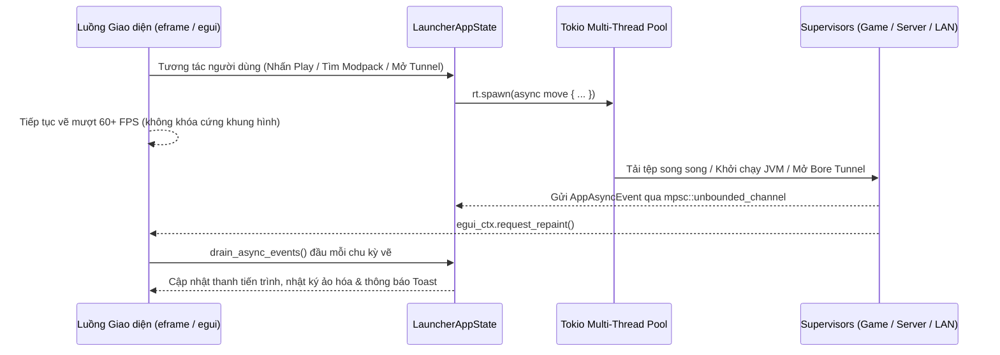

# Kiến Trúc Hệ Thống — TriHienKun Laucher

Tài liệu này mô tả kiến trúc tổng thể, sơ đồ phụ thuộc giữa 9 crates trong Cargo Workspace, luồng giao tiếp bất đồng bộ giữa `tokio` và `egui`, quy trình khởi chạy đa tiến trình Minecraft (`InstanceSupervisor`), đồng bộ Mojang Skin/Cape Cloud & máy chủ Yggdrasil cục bộ, trình quản trị máy chủ chuyên dụng (`LocalServerSupervisor`) và đường ống đồ họa 3D `wgpu`.

---

## 1. Tổng Quan Công Nghệ & Ràng Buộc Kỹ Thuật

- **Ngôn ngữ & Biên dịch**: Rust Edition 2021 (`1.85+`), cấu hình tối ưu hóa Release `opt-level = 3`, `lto = "thin"`, `codegen-units = 1`, `strip = "symbols"`; kịch bản biên dịch `crates/thk-app/build.rs` (`winresource`) nhúng trực tiếp `assets/icons/icon.ico` và siêu dữ liệu PE vào tệp `.exe` gốc.
- **An toàn bộ nhớ tuyệt đối**: Toàn bộ 9 crates trong workspace đều khai báo `#![deny(unsafe_code)]` ở cấp gốc (`lib.rs` / `main.rs`) và `unused_must_use = "deny"` trong `Cargo.toml`.
- **Khung giao diện & Đồ họa GPU**: `eframe 0.37.0` + `egui 0.37.0` + `egui-wgpu 0.37.0` chạy trực tiếp trên `wgpu 30.0.1` (DX12 / Vulkan / Metal) — hoàn toàn không sử dụng Electron, Node.js hay WebView2; hỗ trợ song ngữ Tiếng Việt / Tiếng Anh 100% trên mọi giao diện và khay hệ thống.
- **Runtime bất đồng bộ**: `tokio 1.54.1` (`rt-multi-thread`) xử lý toàn bộ mạng HTTP/2 (`reqwest 0.13.5`), tiến trình con JVM, quét UDP Multicast, đường hầm TCP (`bore-cli 0.6.0`) và máy chủ HTTP cục bộ (`axum 0.8.9`).
- **Lưu trữ bền vững**:
  - Cấu hình, Profile, Tài khoản, Máy chủ, Thống kê giờ chơi: SQLite nhúng (`rusqlite 0.41.1`, tính năng `bundled`) vận hành ở chế độ `WAL` (`Write-Ahead Logging`) kèm cơ chế di trú cột tự động (`ensure_column`).
  - Khóa truy cập và làm mới OAuth2 Microsoft: Lưu trữ mã hóa cấp hệ điều hành thông qua `keyring 3.6.3` (`Windows Credential Manager`, `macOS Keychain`, `Linux Secret Service`).

---

## 2. Sơ Đồ Phụ Thuộc Cargo Workspace (9 Crates)

### Chi Tiết Vai Trò Từng Crate

| Crate | Các Module Chính | Trách Nhiệm Cốt Lõi |
| :--- | :--- | :--- |
| `crates/thk-core` | `paths`, `db`, `downloader`, `archive`, `hash`, `i18n`, `models`, `error` | Định nghĩa mô hình miền, đường dẫn chuẩn `.TriHienKunLaucher`, bộ kiểm tra chống thoát thư mục `SafePath`, nhân bản cây thư mục Profile & dọn bộ nhớ đệm, SQLite WAL tự nâng cấp cột, `DownloadManager` (`2..=32` luồng, kiểm tra `SHA-1`/`SHA-256`/`SHA-512`), giải nén ZIP/TAR.GZ chống Zip-Slip và đa ngôn ngữ `vi`/`en`. |
| `crates/thk-auth` | `microsoft`, `offline`, `token_store`, `yggdrasil` | Luồng đăng nhập Microsoft (Device Code, Desktop Redirect PKCE S256, Loopback PKCE S256) → Xbox Live → XSTS → Minecraft Services; đồng bộ Skin & Active Cape, tải Skin `.png` lên Mojang (`POST /minecraft/profile/skins`) và khôi phục Skin mặc định (`DELETE /minecraft/profile/skins/active`); OS Keyring; Offline UUID v3 và máy chủ Yggdrasil cục bộ. |
| `crates/thk-java` | `scanner`, `mojang_jre`, `distros` | Tự động ánh xạ phiên bản Minecraft sang chuẩn Java (`8`, `17`, `21`, `25`), dò tìm Java trên máy, tải Mojang JRE theo manifest chính thức và cài đặt trực tiếp các gói `Adoptium`, `Azul Zulu`, `GraalVM`. |
| `crates/thk-mods` | `modrinth`, `curseforge`, `ftb`, `technic`, `spiget`, `matcher`, `provider` | Tích hợp API tìm kiếm có phân trang, phân giải phụ thuộc đệ quy và cài đặt gói nội dung từ 5 nhà cung cấp; kiểm tra cập nhật hàng loạt (`check_local_content_updates`), quản lý tệp `.jar` trong `plugins/` & `mods/` của máy chủ cục bộ; nhập `.mrpack` / `.zip` và đối chiếu `SHA-1`. |
| `crates/thk-launcher` | `vanilla`, `loaders`, `supervisor`, `crash` | Đánh giá quy tắc điều kiện hệ điều hành/kiến trúc Mojang, hợp nhất thư viện Maven theo khóa chống trùng lặp `(group, artifact, classifier)`, cài đặt 5 Mod Loaders, truyền độ phân giải cửa sổ tùy chỉnh / `--fullscreen` và mức ưu tiên CPU cao (`ABOVE_NORMAL_PRIORITY_CLASS`), quản lý đa phiên bản game chạy song song và `CrashAnalyzer`. |
| `crates/thk-server` | `jars`, `manager`, `config_files` | Tải và cài đặt tự động 10 lõi máy chủ chuyên dụng, giám sát tiến trình máy chủ (`sysinfo` đo CPU/RAM thực tế, đếm người chơi trực tuyến), lọc ký tự điều khiển đầu vào Console, trình quản lý tệp an toàn và chỉnh sửa `server.properties` / `whitelist.json` / `banned-players.json`. |
| `crates/thk-network` | `ping`, `lan_tunnel`, `discord_rpc` | Thực thi giao thức Minecraft Server List Ping (kèm phân giải bản ghi DNS `_minecraft._tcp` SRV và định dạng màu MOTD), lắng nghe gói quảng bá `Open to LAN` có xác thực IP card mạng nội bộ, nhúng trực tiếp thư viện `bore-cli` mở đường hầm TCP và đồng bộ trạng thái Discord Rich Presence. |
| `crates/thk-renderer3d` | `geometry`, `pipeline`, `skin_image` | Xây dựng lưới nhân vật 3D 2 lớp (Inner Body + Outer Overlay + Cape + Elytra), bệ sân khấu bát giác 3D kèm vòng năng lượng Hologram (`build_stage_pedestal_meshes`), chuyển đổi skin `64x32` sang `64x64`, kết xuất MSAA 4x bằng cặp WGSL shader (`SKIN_SHADER_WGSL` + `STAGE_SHADER_WGSL`) có chiếu sáng viền Fresnel và làm mượt camera lò xo mũ (`snap_to_preset`). |
| `crates/thk-app` | `main`, `build`, `fx3d`, `state`, `theme`, `audio`, `tray`, `updater`, `views/*` | Điểm vào ứng dụng Desktop, nhúng biểu tượng PE `build.rs`, bộ máy đồ họa giao diện 3D 60 FPS (`fx3d`) & 6 bảng màu `AccentPreset`, điều phối bất đồng bộ, âm thanh `rodio`, khay hệ thống `tray-icon` đồng bộ ngôn ngữ trực tiếp và bộ tự cập nhật khởi động lại (`apply_downloaded_update`). |

---

## 3. Mô Hình Sự Kiện Bất Đồng Bộ Không Chặn Luồng Giao Diện

Luồng giao diện `egui` không bao giờ chờ mạng hay đĩa cứng đồng bộ. Mọi tác vụ I/O đều chạy trên `tokio::runtime::Handle` và đẩy sự kiện về kênh không giới hạn `mpsc::UnboundedSender<AppAsyncEvent>` kèm lời gọi `egui_ctx.request_repaint()`:

---

## 4. Quy Trình Khởi Chạy Đa Tiến Trình (`InstanceSupervisor`)

`InstanceSupervisor` định danh mỗi phiên chơi bằng khóa kép `InstanceKey { profile_id, account_id }`, cho phép chạy song song nhiều Profile hoặc nhiều tài khoản cùng lúc mà không ghi đè trạng thái của nhau:

1. **Làm mới Xác thực (`ensure_valid_minecraft_token`)**:
   - Tài khoản Microsoft: Kiểm tra hạn token; nếu sắp hết hạn trong vòng 5 phút sẽ tự động dùng `ms_refresh_token` từ OS Keyring để lấy token mới đồng thời cập nhật `skin_url` và `cape_url` mới nhất từ Mojang.
   - Tài khoản Offline có gắn Skin / Cape / Elytra tùy chỉnh: Tự động kiểm tra `authlib-injector.jar` và khởi tạo máy chủ HTTP Yggdrasil cục bộ trên `127.0.0.1:0` (cổng ngẫu nhiên do hệ điều hành cấp phát), truyền cờ `-javaagent:<authlib>=http://127.0.0.1:<port>` vào JVM.
2. **Chuẩn bị Java Runtime (`RequiredJavaSpec` + `ensure_mojang_java`)**:
   - Đọc trường `javaVersion` từ manifest phiên bản hoặc suy luận chính xác theo thế hệ Minecraft (`<= 1.16.5` → Java 8; `1.17.x` → Java 17; `1.18–1.20.4` → Java 17; `1.20.5–1.21.x` → Java 21; `26.x+` → Java 25).
   - Nếu người dùng không chỉ định đường dẫn Java riêng trên Profile, tự động tải và xác thực từng tệp của Mojang JRE chính thức vào `runtimes/`.
3. **Đồng bộ Tệp Gốc & Mod Loader (`prepare_vanilla_files` + `prepare_loader_patch`)**:
   - Tải song song `client.jar`, thư viện Maven, thư viện gốc (`natives`) và đối tượng tài nguyên (`assets/objects`) có kiểm tra mã băm `SHA-1`.
   - Cài đặt và hợp nhất cấu hình của `Fabric`, `Quilt`, `Forge` (hỗ trợ cả trình cài đặt tự động kèm `ForgeWrapper` cho `1.13+` và `universal.jar` cho bản cũ) hoặc `NeoForge`.
   - Khử trùng lặp thư viện trên Classpath theo bộ ba `(group_id, artifact_id, classifier)`.
   - Nếu Profile dùng `Fabric` và bật `auto_perf_mods`, tự động kiểm tra và tải các bản tương thích mới nhất của `Sodium`, `Lithium`, `FerriteCore`, `EntityCulling` và `ModMenu` từ Modrinth.
4. **Tối ưu GPU, Độ Phân Giải Cửa Sổ, Ưu Tiên CPU & Khởi tạo Tiến trình JVM**:
   - Trên Windows, đăng ký khóa `HKCU\Software\Microsoft\DirectX\UserGpuPreferences` (`GpuPreference=2;`) cho tệp thực thi `java.exe` và gắn cờ `ABOVE_NORMAL_PRIORITY_CLASS` (`0x0000_8000`) khi người dùng bật `high_process_priority`.
   - Truyền chính xác `${resolution_width}`, `${resolution_height}`, cờ điều kiện `has_custom_resolution` (`--width` / `--height`) và `--fullscreen` từ cấu hình Profile vào đối số khởi chạy game.
   - Hỗ trợ tự động ẩn cửa sổ Launcher khi game khởi chạy (`hide_launcher_on_launch`) và khôi phục lại khi tiến trình game kết thúc.
5. **Thu thập Nhật ký, Thống kê & Phân tích Crash**:
   - Thu thập bất đồng bộ `stdout` và `stderr` vào bộ đệm vòng `4,000` dòng mỗi tiến trình.
   - Ghi nhận nguyên tử (`atomic SQL UPDATE/UPSERT`) tổng giây chơi, số phiên và biểu đồ ngày vào bảng `profiles` + `daily_play_stats`.
   - Kích hoạt `analyze_crash_logs` khi thoát bất thường và đề xuất nút sửa tự động 1 chạm.

---

## 5. Đường Ống Kết Xuất Nhân Vật 3D (`thk-renderer3d`) & Giao Diện Gaming 3D (`fx3d`)

`SkinPreviewViewport` kết xuất vào đích trung gian khử răng cưa đa mẫu **MSAA 4x** (`Depth24Plus`) trên `egui_wgpu::RenderState` và hiển thị đồng bộ tại cả **Banner Arena Trang chủ** lẫn **Phòng Studio Tài khoản**:

- **Đồng bộ Mojang Cloud & Chuẩn hóa Texture (`skin_image.rs` + `state.rs`)**: Tự động tải và lưu đệm ảnh `skin_url` / `cape_url` từ tài khoản Microsoft vào `account_skins/remote_*.png` và `account_capes/remote_*.png`; chuyển đổi skin cổ điển `64x32` sang `64x64` có lật đối xứng tay/chân trái; hỗ trợ kéo-thả trực tiếp tệp `.png` vào khung 3D.
- **Xây dựng Hình học Nhân vật & Sân khấu Hologram (`geometry.rs`)**:
  - Hỗ trợ cả hai khung xương `Wide` (`4px`) và `Slim` (`3px`), 6 khối cơ thể trong và 6 khối lớp phủ ngoài, áo choàng `Cape` và cánh `Elytra`.
  - Sinh động lưới sân khấu 3D (`build_stage_pedestal_meshes`): đài bát giác 2 tầng, tâm phát sáng nhịp thở, 2 vòng năng lượng Hologram xoay ngược chiều và 6 tinh thể Voxel bay quỹ đạo 3D.
- **Cặp Shader WGSL & Camera Lò xo (`pipeline.rs`)**:
  - `STAGE_SHADER_WGSL` và `SKIN_SHADER_WGSL` áp dụng chiếu sáng khuếch tán hai nguồn cùng viền sáng kép **Fresnel Rim** (Emerald + Violet); góc camera nội suy mượt theo hàm mũ (`1 - exp(-14 * dt)`).
- **Bộ máy Hoạt ảnh Giao diện 3D (`crates/thk-app/src/fx3d.rs`)**:
  - `Poly3dBuffer` kết xuất 9 biểu tượng 3D đa bộ phận ở tốc độ 60 FPS cùng hệ thống thẻ vát cạnh `gaming_card_3d`, nút cơ học `tactile_button_3d`, thanh chuyển tab trượt `sliding_pill_tabs`, biểu đồ cột khối Voxel Isometric 3D và ống dẫn gói tin Bore.
