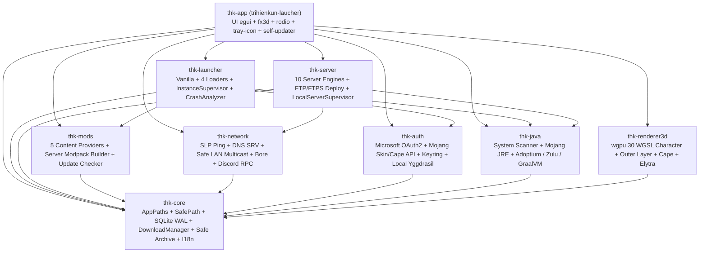
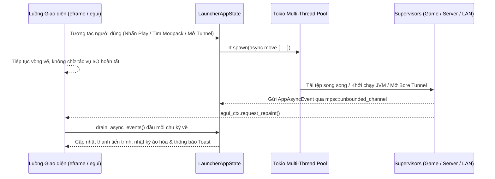

# Kiến Trúc Hệ Thống — TriHienKun Laucher

Tài liệu này mô tả kiến trúc tổng thể, sơ đồ phụ thuộc giữa 9 crates trong Cargo Workspace, luồng giao tiếp bất đồng bộ giữa `tokio` và `egui`, quy trình khởi chạy đa tiến trình Minecraft (`InstanceSupervisor`), đồng bộ Mojang Skin/Cape Cloud & máy chủ Yggdrasil cục bộ, trình quản trị máy chủ chuyên dụng (`LocalServerSupervisor`) và đường ống đồ họa 3D `wgpu`.

---

## 1. Tổng Quan Công Nghệ & Ràng Buộc Kỹ Thuật

- **Ngôn ngữ & Biên dịch**: Rust Edition 2021, dùng stable hiện hành (mốc Windows 08/11/2026: `rustc 1.99.1`, quy mô **`80` tệp `.rs`** / **`67.071` dòng mã Rust** trên 9 crates; chưa có MSRV được kiểm thử), cấu hình tối ưu hóa Release `opt-level = 3`, `lto = "thin"`, `codegen-units = 1`, `strip = "symbols"`; xuất gói thực thi gốc cho **6 nền tảng** (`windows-x64`, `linux-x64`, `linux-arm64`, `macos-arm64`, `macos-x64` và `android-arm64`), trong đó `crates/thk-app/build.rs` (`winresource`) nhúng trực tiếp `assets/icons/icon.ico` và siêu dữ liệu PE vào tệp `.exe` trên Windows, đồng thời `crates/thk-app/src/lib.rs` xuất thư viện động `cdylib` (`libthk_app.so` căn chỉnh trang nhớ `16 KB` `PT_LOAD` qua `scripts/build-android-apk.ps1`) cho gói **Android Native `arm64-v8a`**.
- **Ràng buộc mã Rust**: 9 crates khai báo `#![deny(unsafe_code)]` ở cấp gốc (`lib.rs` / `main.rs`, chỉ miễn trừ đúng 1 chữ ký xuất biểu tượng `#[cfg(target_os = "android")] #[allow(unsafe_code)] #[no_mangle] pub fn android_main` không chứa khối `unsafe` cho `android-activity`) và `unused_must_use = "deny"` trong `Cargo.toml`; không phải bảo đảm an toàn tuyệt đối cho dependency, driver hoặc lỗi logic.
- **Khung giao diện & Đồ họa GPU**: `eframe 0.37.0` + `egui 0.37.0` + `egui-wgpu 0.37.0` chạy trực tiếp trên `wgpu 30.0.1` (DX12 / Vulkan / Metal / GLES3) — hoàn toàn không sử dụng Electron, Node.js hay WebView2; hỗ trợ song ngữ Tiếng Việt / Tiếng Anh 100% trên mọi giao diện và khay hệ thống.
- **Runtime bất đồng bộ**: `tokio 1.54.1` (`rt-multi-thread`) xử lý toàn bộ mạng HTTP/2 (`reqwest 0.13.5` + `rustls` `ring` + `webpki-roots`), tiến trình con JVM (trên Desktop), quét UDP Multicast, đường hầm TCP (`bore-cli 0.6.0`) và máy chủ HTTP cục bộ (`axum 0.8.9`).
- **Lưu trữ bền vững**:
  - Cấu hình, Profile, Tài khoản, Máy chủ, Thống kê giờ chơi: SQLite nhúng (`rusqlite 0.41.1`, tính năng `bundled`) vận hành ở chế độ `WAL` (`Write-Ahead Logging`) kèm cơ chế di trú cột tự động (`ensure_column`).
  - Khóa truy cập OAuth2 Microsoft và mật khẩu FTP/FTPS: Trên Desktop lưu trữ mã hóa cấp hệ điều hành thông qua `keyring 3.6.3` (`Windows Credential Manager`, `macOS Keychain`, `Linux Secret Service`); trên Android lưu trong thư mục riêng theo UID ứng dụng `.TriHienKunLaucher/.credentials/*.sec` (`0o700` / `0o600`, `android:allowBackup="false"`).

---

## 2. Sơ Đồ Phụ Thuộc Cargo Workspace (9 Crates)

### Chi Tiết Vai Trò Từng Crate

| Crate | Các Module Chính | Trách Nhiệm Cốt Lõi |
| :--- | :--- | :--- |
| `crates/thk-core` | `paths`, `db`, `downloader`, `archive`, `hash`, `i18n`, `models`, `mobile_controls`, `error` | Định nghĩa mô hình miền, đường dẫn chuẩn `.TriHienKunLaucher`, cầu nối Android `.thk_bridge` (`AndroidPermissionStatus`, `android_bridge_send_cmd`, `poll_android_focus_request`), mô hình bố cục phím cảm ứng Bedrock & Chuột Ảo (`MobileControlLayout`, `mobile_controls.json`), chống thoát thư mục `SafePath`, quét dữ liệu phục hồi (`scan_recovery_artifacts`), nhân bản cây thư mục Profile & dọn bộ nhớ đệm, SQLite WAL tự nâng cấp cột + triggers dọn dẹp + giao dịch `commit_installed_content` / `upsert_profile_with_installed_content`, `DownloadManager` (`2..=32` luồng, retry/backoff `429`/`5xx`, `spawn_blocking` khi băm tệp, `force_overwrite`), giải nén chống Zip-Slip hỗ trợ hủy cho cả `.zip`, `.tar.gz` và `.tar.xz` (`extract_zip_prefix_cancellable`, `extract_targz_cancellable`, `extract_tarxz_cancellable` dùng `lzma-rust2`) và đa ngôn ngữ `vi`/`en`. |
| `crates/thk-auth` | `microsoft`, `offline`, `token_store`, `yggdrasil` | Luồng đăng nhập Microsoft (Device Code, Desktop Redirect PKCE S256, Loopback PKCE S256 lưu riêng `oauth_client_id` theo từng tài khoản, kiểm chặt `state` & đóng cổng qua `child_token` + `drop_guard`) → Xbox Live → XSTS → Minecraft Services; đồng bộ Skin & Active Cape, tải/khôi phục Skin Mojang (tự chuẩn hóa ảnh HD `128×128+` / `64×32` sang `64×64` premultiplied-alpha qua `normalize_skin_png_bytes_for_minecraft`); OS Keyring tách khóa `:mc`/`:ms`; Offline UUID v3 và máy chủ Yggdrasil cục bộ ký `SHA1withRSA`, định danh URL texture theo `SHA-256` không tham số truy vấn (`SKIN`, `CAPE`, `ELYTRA`), truyền `-Dauthlibinjector.yggdrasil.prefetched`, hỗ trợ tra cứu `/api/users/profiles/minecraft/{username}` + `/api/profiles/minecraft` + `hasJoined` và kiểm chứng `AUTHLIB_INJECTOR_SHA256`. |
| `crates/thk-java` | `scanner`, `mojang_jre`, `distros`, `build.rs` | Ánh xạ phiên bản Minecraft sang chuẩn Java (`8`, `16`, `17`, `21`, `25`), phân giải tự động chế độ tối ưu `ensure_optimal_java` (`GraalVM 17 / 21 / 25` có kiểm `SHA-256` trên Desktop, giữ `Java 8` cho `MC <= 1.16.5` và dự phòng Mojang JRE; trên Android `aarch64` tự động cài `OpenJDK 8 / 17 / 21 / 25` Bionic `.tar.xz` có kiểm `SHA-256`, cấp quyền `0o755`, cấu hình `LD_LIBRARY_PATH`/`TMPDIR`/`HOME` và nạp shim `libthk_jvm_shim.so` tắt Bionic Heap Pointer Tagging qua `LD_PRELOAD`), ánh xạ 5 thành phần Mojang (`jre-legacy`, `alpha`, `gamma`, `delta`, `epsilon`, hỗ trợ cả `linux-arm64` & symlink nội bộ), kiểm tra hậu nghiệm `major_version` và cài đặt thủ công `Adoptium`, `Azul Zulu`, `GraalVM` / `AndroidOpenJdk`. |
| `crates/thk-mods` | `modrinth`, `curseforge`, `ftb`, `technic`, `spiget`, `install`, `server_pack`, `matcher`, `provider` | Tìm kiếm có phân trang, phân giải phụ thuộc đệ quy và cài đặt nội dung theo giao dịch (`install_content_batch` dùng `.thk-install-<UUID>`) từ 5 nhà cung cấp; kiểm tra cập nhật hàng loạt ưu tiên `Release` (`check_local_content_updates` + vân tay Murmur2 CurseForge), khởi tạo máy chủ chuyên dụng trực tiếp từ 4 kho Cloud (`populate_server_from_cloud_modpack`, ưu tiên `serverPackFileId` trên CurseForge), từ tệp `.mrpack` / CurseForge `.zip` / gói Server `.zip` hoặc nhân bản từ Profile có sẵn (`server_pack.rs`, lọc bỏ mod chỉ dành cho Client), tự nhận diện loader Technic, lấy phiên bản Spiget an toàn và quản lý `plugins/` & `mods/` máy chủ. |
| `crates/thk-launcher` | `vanilla`, `loaders`, `supervisor`, `mobile_jvm`, `crash` | Đánh giá quy tắc điều kiện hệ điều hành/kiến trúc Mojang (kể cả Linux `aarch64`, bỏ qua gói desktop `:natives-*` và nâng cấp `jna` / `oshi-core` / `asm-all` trên Android), hợp nhất thư viện Maven theo `(group, artifact, classifier)`, cài đặt Vanilla + 4 Mod Loaders (hỗ trợ cả Modern Forge `ForgeBootstrap` `1.20.3–1.21.4+`, Legacy Forge `1.7.10–1.12.2`, đệm JSON ngoại tuyến Fabric/Quilt và `${game_assets}` `assets/virtual/<id>`), xây dựng đặc tả khởi chạy Android LWJGL3 / OpenGL ES (`build_mobile_launch_spec`, `Holy-GL4ES` / `MobileGlues`, truyền nhận phím/chuột/cửa sổ độ trễ thấp `TCP_NODELAY` trên `127.0.0.1` với tiến trình `:game` `GameJvmService` qua `run_android_jvm_session`), nối `CancellationToken` giai đoạn chuẩn bị, cô lập `natives` theo phiên và `CrashAnalyzer` (hỗ trợ sửa thiếu Mod & nâng cấp Mod Loader). |
| `crates/thk-server` | `jars`, `manager`, `cpu`, `config_files`, `ftp_deploy` | Tải 10 lõi máy chủ chuyên dụng (Paper/Folia Fill v3 `STABLE`, Mohist lọc bản có build thật, Arclight nhận diện đúng `neoforge`/`fabric`/`forge`, SpongeVanilla sắp xếp ngữ nghĩa `RC10 > RC9`, Forge/NeoForge `@args`), kiểm tra `eula.txt`, cổng TCP đang bận (`resolve_effective_server_port`) và `major_version` Java trước khi mở JVM, truyền cờ tắt JLine cho ống dẫn `stdin` ẩn (`-Dterminal.jline=false -Dterminal.ansi=false -Djline.terminal=jline.UnsupportedTerminal`), lọc mã ANSI/NUL (`strip_console_ansi_and_noise`) & tự thu dọn JVM treo sau lỗi khởi tạo/tắt máy, triển khai dữ liệu máy chủ/modpack lên Hosting qua FTP / Explicit FTPS (`suppaftp` + `rustls` + OS Keyring `server-ftp:<id>`), phân giải UUID thật (Mojang Online / Offline v3) cho `whitelist.json` & `banned-players.json`, nhận diện phần cứng CPU/SoC đa nền tảng (`CpuHardwareInfo`) & đo phần trăm CPU / số lõi thực dùng từ độ chênh `accumulated_cpu_time()` (`compute_process_cpu_sample`, không phụ thuộc `/proc/stat` bị SELinux chặn trên Android) và quản lý tệp an toàn. |
| `crates/thk-network` | `ping`, `direct_host`, `lan_tunnel`, `discord_rpc` | Thực thi giao thức Minecraft Server List Ping (hỗ trợ IPv6, giữ nguyên hostname gốc trong Handshake sau phân giải SRV và màu hex `§x` MOTD), mở cổng trực tiếp trên mạng đang kết nối (`direct_host`: nhận diện giao diện LAN/Wi-Fi/Hotspot/VPN đang hoạt động đa nền tảng kèm `.thk_bridge/networks.json` + `WifiManager.MulticastLock` trên Android, cầu nối TCP dual-stack IPv4 + `IPV6_V6ONLY` với `TCP_NODELAY`, phát sóng `[MOTD]...[/MOTD][AD]<port>[/AD]` mỗi `1.5s`, địa chỉ Online IPv6 toàn cục `2000::/3` và tự động mở cổng Modem qua UPnP IGD SSDP/SOAP có phát hiện CGNAT `100.64.0.0/10`), lắng nghe `Open to LAN` trên `SO_REUSEADDR` cổng `4445` có xác thực IP card mạng nội bộ & chống tự lặp `self_hosted_lan_port`, đường hầm dự phòng `bore-cli`, và đồng bộ Discord Rich Presence tự kết nối lại. |
| `crates/thk-renderer3d` | `geometry`, `pipeline`, `skin_image` | Xây dựng lưới nhân vật 3D 2 lớp cùng Cape & Elytra kết xuất 2 lượt (`cutout_pipeline` ghi chiều sâu + `translucent_pipeline` trộn alpha kèm định hướng pháp tuyến `@builtin(front_facing)`), trích xuất Skin Steve `64×64` nguyên bản từ `client.jar` (`extract_vanilla_steve_skin`), tự nhận diện `Wide`/`Slim` khi nhập Skin (`detect_skin_variant`), bệ bát giác 2 tầng tối giản, kết xuất MSAA 4x theo nhu cầu (`low_power` & `release_offscreen_target`) với hiệu chỉnh tuyến tính sang sRGB trong WGSL shader. |
| `crates/thk-app` | `lib`, `main`, `build`, `dialogs`, `ui_assets`, `fx3d`, `state`, `theme`, `audio`, `tray`, `pack_install`, `updater` (+ `apply_update.ps1`), `views/*` (`mobile_game`, `visual_tests`) | Điểm vào Desktop (`eframe::App::logic` đánh thức tức thì từ System Tray, hỗ trợ **Đa cửa sổ OS gốc** qua `show_viewport_immediate` gồm `thk_secondary_workspace`, `thk_detached_game_logs`, `thk_detached_server_console` & giải phóng bộ nhớ GPU/ảnh khi thu ẩn qua `trim_launcher_memory`) & Android (`wgpu` GLES `ALPHA_SIZE = 8` + `PixelFormat.TRANSLUCENT` ghép phần cứng trên `SurfaceView` có ghi đè `gatherTransparentRegion` giữ trọn vùng hiển thị `[0, 0, W, H]`), **bộ tài sản Game UI RGBA tạo bởi AI (`ui_assets.rs`: 6 đế nút 9-slice + 16 biểu tượng 3D)**, **bố cục đáp ứng Dọc & Ngang (`is_compact_portrait`: thanh công cụ đỉnh + thanh Dock đáy `4` tab trên Desktop hẹp / `5` tab trên Android + ngăn kéo bộ lọc Modpack + neo cứng khung thanh bên qua `locked_panel_body`)**, **Màn hình Run Game trên Mobile (`mobile_game.rs`)** 100% Pure Safe Rust (cụm D-Pad 3×3 Bedrock vẽ vector thủ tục, nút tùy biến đa chạm, Chuột Ảo + bàn rê góc nhìn, trình `Edit Phím` trực tiếp và Menu Nổi `HUB` bật/ẩn nhanh **HUB UI** + nút xoay màn hình), Chế độ Siêu tiết kiệm RAM (`low_ram_mode`), quản lý đa tiến trình có khóa `active_tasks` + hủy toàn cục, Trạm Cài Đặt Modpack 2 đích (Profile / Máy chủ), hộp thoại Nhập Modpack từ đĩa / Tạo Máy chủ 4 chế độ / Xác nhận EULA / Xác nhận Xóa, giao dịch cài modpack ghi nguyên tử `installed_content` và bộ cập nhật đa nền tảng (`expected_asset_name_for` cho 6 mục tiêu phát hành). |

---

## 3. Giao Dịch Cài Đặt Nội Dung, Modpack & Self-Updater

### 3.1. Cài đặt nội dung theo batch (`thk-mods::install`)

Modrinth, CurseForge và bộ mod hiệu năng Fabric dùng `thk-mods::install` để tải vào thư mục `.thk-install-<UUID>` bên trong thư mục nội dung đích. Chỉ sau khi tải và kiểm tra hash hoàn tất, bộ cài mới sao lưu các tệp được quản lý, tạo tệp đích không ghi đè và ghi metadata bằng một giao dịch SQLite. Cập nhật giữ trạng thái bật/tắt; tệp không được quản lý hoặc thuộc dự án khác bị từ chối ghi đè.

Khi một lượt tải trong batch thất bại, `DownloadManager` hủy các worker còn lại bằng token con và chờ chúng đóng tệp, dọn `.part` trước khi trả lỗi đầu tiên. Token của tác vụ cha không bị hủy do lỗi của batch. Tải lỗi hoặc người dùng hủy qua token trước giai đoạn commit không thay đổi các tệp nội dung đã cài và metadata; vùng staging được dọn khi bộ cài kết thúc. Nếu hệ điều hành từ chối dọn staging, lỗi được ghi log. Việc drop/abort future trực tiếp không bảo đảm hoàn tất dọn tệp bất đồng bộ.

Nếu đổi tệp hoặc ghi SQLite thất bại, bộ cài khôi phục tệp cũ. Khi khôi phục thất bại, vùng staging và `recovery.json` được giữ lại để đối chiếu đường dẫn gốc, bản sao lưu và metadata. Đây là rollback lỗi trong tiến trình, **không phải giao dịch nguyên tử giữa filesystem và SQLite khi mất điện hoặc process crash**; chưa có tự động khôi phục sau crash hay khóa liên tiến trình. Không xóa vùng recovery trước khi kiểm tra tệp và bản ghi SQLite.

### 3.2. Cài và nhập modpack vào Profile mới (`thk-app::pack_install`)

Luồng nhập archive từ đĩa (qua hộp thoại tùy chỉnh Tên / RAM / Thư mục) và cài từ Modrinth/CurseForge/FTB/Technic đều dùng `thk-app::pack_install::PackInstallation`: tải và giải nén vào `.thk-pack-<UUID>/payload` cạnh thư mục instance, không ghi trực tiếp vào thư mục tùy chọn của người dùng. Với gói CurseForge nhiều mod, manifest được phân giải hàng loạt qua `POST /v1/mods/files` (khi cấu hình khóa API chính thức) kết hợp luồng đồng thời 16 kết nối (`buffer_unordered(16)`) có phát tiến trình theo thời gian thực ở cả 4 chặng (`Downloading ZIP` → `Resolving Modpack Manifest` → `Importing` → `Extracting Modpack Overrides` → `Finalizing Modpack`). Thư mục đích phải chưa tồn tại hoặc rỗng, không phải symlink và không thuộc Profile khác. Bộ cài chạy `commit_with_progress` trên `tokio::task::spawn_blocking`, kiểm tra lại trước commit, ưu tiên liên kết cứng cùng phân vùng (`fs::hard_link`, từ chối ngay `AlreadyExists` và dự phòng sao chép độc quyền `create_new` trên hệ tệp không hỗ trợ hardlink), chỉ lưu nguyên tử cả Profile lẫn danh sách `installed_content` vào SQLite (`upsert_profile_with_installed_content`) sau khi hoàn tất tệp và kiểm tra token hủy.

Lỗi hoặc hủy trước commit dọn staging (cả tệp archive tạm trong `cache/`); lỗi sao chép/SQLite hoàn tác riêng các tệp và thư mục được lượt cài tạo ra, giữ nguyên thư mục rỗng có sẵn. Nếu rollback lỗi, giữ payload cùng `recovery.json` và trả đường dẫn phục hồi. Khóa commit chỉ có hiệu lực trong một tiến trình; không bảo đảm chống tác nhân ngoài thay đổi đường dẫn/tệp đồng thời, không crash-atomic giữa filesystem và SQLite, và không tự phục hồi sau mất điện. Drop/abort future trong lúc worker giải nén đang chạy không bảo đảm dọn sạch; hủy bằng token là luồng được hỗ trợ.

Cả luồng cài trực tuyến lẫn hộp thoại **Nhập Modpack từ đĩa** đều truyền `CancellationToken` vào `extract_zip_prefix_cancellable`: kiểm tra trước tạo thư mục/mở ZIP, trước mỗi entry, trước/sau mỗi lần đọc tối đa 64 KiB và trước trả thành công. Tệp dở có thể còn trong payload; caller phải chờ `spawn_blocking` kết thúc trước khi dọn staging, không abort worker để giả lập hủy. Không bảo đảm thời gian hủy khi một thao tác I/O của hệ điều hành bị chặn. `client-overrides` vẫn ghi sau `overrides`. CurseForge, FTB và Technic dừng ngay nếu không tải/resolve được tệp bắt buộc hoặc tên tệp không an toàn, không tạo Profile thiếu mod bắt buộc. Đang resolve metadata có thể hủy qua `tokio::select!`.

Regression Windows khóa tệp bằng sharing mode không cho xóa, gọi trực tiếp nhánh rollback trên trạng thái sau sao chép được dựng trong thư mục cô lập, rồi kiểm tra payload và `recovery.json` còn nguyên sau `Drop`. Bài này không dùng đua thời gian và không chứng minh một lượt cài từ nhà cung cấp thật đã gặp lỗi rollback.

### 3.3. Nhận diện gói phát hành 6 nền tảng & áp dụng cập nhật portable (`thk-app::updater` + `apply_update.ps1`)

Kiểm tra bản phát hành lúc khởi động và kiểm tra thủ công truy vấn danh sách `releases?per_page=20`, lọc bản phát hành chính thức (`!draft && !prerelease`), ánh xạ chính xác gói theo `(OS, ARCH)` qua `expected_asset_name_for` (`trihienkun-laucher-windows-x64.exe`, `trihienkun-laucher-android-arm64.apk`, `trihienkun-laucher-linux-x64`, `trihienkun-laucher-linux-arm64`, `trihienkun-laucher-macos-arm64`, `trihienkun-laucher-macos-x64` đối chiếu với `SHA256SUMS.txt` hoặc `digest` của GitHub Release) và dùng chung một luồng xử lý lỗi. Kho GitHub hợp lệ nhưng chưa đăng tải bản phát hành nào trả trạng thái `NoPublishedReleases` tường minh thay vì quăng lỗi `HTTP 404`; mọi lỗi HTTP, mạng hoặc cấu hình kho lưu trữ vẫn được giữ nguyên, không bao giờ chuyển thành kết quả “phiên bản mới nhất”.

`VerifiedUpdate` giữ đường dẫn cùng SHA-256 từ metadata phát hành đã dùng khi tải. Trước khi gọi helper, launcher kiểm tra lại tệp cache; helper cũng kiểm tra SHA-256 của bản staging nằm cùng thư mục executable. Helper dùng config JSON thay vì ghép đường dẫn vào mã PowerShell, chờ launcher thoát tối đa 20 giây và từ chối nếu launcher chưa thoát.

Mỗi lượt áp dụng có staging/backup riêng theo UUID. Khóa `.<executable>.update-lock` được tạo độc quyền để chặn hai helper cùng thay executable; không ghi đè khóa hoặc recovery có sẵn. `System.IO.File.Replace` thay executable và giữ bản cũ. Nếu `Start-Process` báo lỗi, helper khôi phục bản cũ và giữ bản cập nhật lỗi ở tệp `.failed`; nếu rollback thất bại, bản `.backup` được giữ nguyên. Log nằm cạnh config trong `cache/updates/apply-<UUID>/`, gồm `config.json.log` và `config.stderr.log`.

Khởi tạo process thành công **không chứng minh phiên bản mới chạy khỏe**. Chưa có health handshake, tự phục hồi sau mất điện/process crash hoặc tự dọn backup/khóa còn lại sau crash; cần kiểm tra log và recovery trước khi xóa thủ công. SHA-256 ở đây xác minh theo metadata GitHub, không thay thế chữ ký nhà phát hành. Chuẩn bị/áp dụng chạy qua `spawn_blocking` và gửi `UpdateApplyCompleted`; guard `updater.applying` ngăn thao tác lặp, launcher chỉ đóng sau khi helper spawn thành công. Lệnh kiểm thử và phạm vi runtime đã xác minh: [TESTING.md](TESTING.md).

---

## 4. Mô Hình Sự Kiện Bất Đồng Bộ Không Chặn Luồng Giao Diện

Luồng giao diện `egui` không bao giờ chờ mạng hay đĩa cứng đồng bộ. Mọi tác vụ I/O đều chạy trên `tokio::runtime::Handle` và đẩy sự kiện về kênh không giới hạn `mpsc::UnboundedSender<AppAsyncEvent>` kèm lời gọi `egui_ctx.request_repaint()`:

`InstanceSupervisor::launch_async` nhận trực tiếp `Handle` của ứng dụng và dùng `Handle::spawn`, không yêu cầu luồng giao diện phải ở trong ngữ cảnh Tokio. Lỗi pipeline được gửi qua `LauncherEvent::LaunchFailed` thay vì làm panic luồng giao diện.

`LanShareCoordinator::start_lan_scan` cũng nhận `Handle` này: socket UDP được đăng ký trong ngữ cảnh runtime và worker nhận gói chạy bằng `Handle::spawn`, nên thao tác quét LAN từ luồng giao diện không yêu cầu runtime ngầm định.

---

## 5. Quy Trình Khởi Chạy Đa Tiến Trình (`InstanceSupervisor`) & Máy Chủ Cục Bộ (`LocalServerSupervisor`)

`InstanceSupervisor` định danh mỗi phiên chơi bằng khóa kép `InstanceKey { profile_id, account_id }`, cho phép chạy song song nhiều Profile hoặc nhiều tài khoản cùng lúc mà không ghi đè trạng thái của nhau:

1. **Làm mới Xác thực (`ensure_valid_minecraft_token`)**:
   - Tài khoản Microsoft: Kiểm tra hạn token; nếu sắp hết hạn trong vòng 5 phút sẽ tự động dùng `ms_refresh_token` từ OS Keyring để lấy token mới đồng thời cập nhật `skin_url` và `cape_url` mới nhất từ Mojang.
   - Tài khoản Offline có gắn Skin / Cape / Elytra tùy chỉnh (hoặc chọn dáng tay `Slim 3px`): Tự động kiểm tra `authlib-injector.jar`, chuẩn hóa ảnh Skin HD `128×128+` / `64×32` sang đúng chuẩn `64×64` mà `HttpTexture` của Minecraft chấp nhận (giữ nguyên tệp HD gốc cho Studio 3D), khởi tạo máy chủ HTTP Yggdrasil cục bộ trên `127.0.0.1:0` với URL texture băm `SHA-256` không tham số truy vấn, ghi nhận trạng thái `[THK]` vào nhật ký phiên và truyền cặp cờ `-Dauthlibinjector.yggdrasil.prefetched=<b64>` cùng `-javaagent:<authlib>=http://127.0.0.1:<port>` vào JVM.
2. **Chuẩn bị Java Runtime (`RequiredJavaSpec` + `ensure_optimal_java` / `ensure_mojang_java`)**:
   - Ưu tiên trường `javaVersion` từ manifest phiên bản; khi không có manifest, suy luận theo thế hệ Minecraft (`<= 1.16.5` → Java 8; `1.17.x` → Java 16; `1.18–1.20.4` → Java 17; `1.20.5–1.21.x` → Java 21; `26.x` → Java 25).
   - Nếu người dùng chỉ định `java_path` riêng trên Profile, kiểm tra sự tồn tại và đối chiếu `major_version >= java_spec.major_version` trước khi chạy.
   - Khi để trống `java_path`: ở chế độ mặc định `JavaRuntimeMode::OptimalGraalVm`, `ensure_optimal_java` tự tái sử dụng hoặc tải `GraalVM Community JDK` tương ứng (`GraalVM 17` cho yêu cầu Java `9..=17`, `GraalVM 21` cho `18..=21`, `GraalVM 25` cho `22..=25` có kiểm `SHA-256`), giữ nguyên `Java 8` (`jre-legacy`) cho `MC <= 1.16.5` và tự dự phòng sang `ensure_mojang_java` nếu lỗi mạng/kiến trúc (trừ khi người dùng chủ động hủy `CancellationToken`); ở chế độ `JavaRuntimeMode::MojangOfficial`, tải trực tiếp Mojang JRE chính thức vào `runtimes/`.
3. **Đồng bộ Tệp Gốc & Mod Loader (`prepare_vanilla_files` + `prepare_loader_patch`)**:
   - Tải song song `client.jar`, thư viện Maven, thư viện gốc (`natives`) và đối tượng tài nguyên (`assets/objects`) có kiểm tra mã băm `SHA-1`.
   - Cài đặt và hợp nhất cấu hình của `Fabric`, `Quilt`, `Forge` (hỗ trợ cả trình cài đặt tự động kèm `ForgeWrapper` cho `1.13+` và `universal.jar` cho bản cũ) hoặc `NeoForge`.
   - Khử trùng lặp thư viện trên Classpath theo bộ ba `(group_id, artifact_id, classifier)`.
   - Nếu Profile dùng `Fabric` và bật `auto_perf_mods`, tự động kiểm tra và tải các bản tương thích mới nhất của `Sodium`, `Lithium`, `FerriteCore`, `EntityCulling` và `ModMenu` từ Modrinth.
4. **Tối ưu GPU, Độ Phân Giải Cửa Sổ, Ưu Tiên CPU & Khởi tạo Tiến trình JVM**:
   - Trên Windows, đăng ký khóa `HKCU\Software\Microsoft\DirectX\UserGpuPreferences` (`GpuPreference=2;`) cho tệp thực thi `java.exe` và gắn cờ `ABOVE_NORMAL_PRIORITY_CLASS` (`0x0000_8000`) khi người dùng bật `high_process_priority`.
   - Truyền chính xác `${resolution_width}`, `${resolution_height}`, cờ điều kiện `has_custom_resolution` (`--width` / `--height`) và `--fullscreen` từ cấu hình Profile vào đối số khởi chạy game.
   - Hỗ trợ tự động ẩn cửa sổ Launcher khi game khởi chạy (`hide_launcher_on_launch`) và khôi phục lại khi tiến trình game kết thúc.
5. **Thu thập Nhật ký, Thống kê & Phân tích Crash**:
   - Thu thập bất đồng bộ `stdout` và `stderr` vào bộ đệm vòng `4,000` dòng mỗi tiến trình.
   - Ghi nhận nguyên tử (`atomic SQL UPDATE/UPSERT`) tổng giây chơi, số phiên và biểu đồ ngày vào bảng `profiles` + `daily_play_stats`.
   - Kích hoạt `analyze_crash_logs` khi thoát bất thường và đề xuất nút sửa tự động 1 chạm.

### Giám Sát & Cài Đặt Máy Chủ Cục Bộ (`LocalServerSupervisor` & `thk-server::jars`)

- **Paper / Folia Downloads Service Fill v3**: Sử dụng `https://fill.papermc.io/v3/projects`; danh sách phiên bản được gộp từ các nhóm và sắp xếp số giảm dần, loại trừ các bản prerelease. Trình cài chỉ chọn build `STABLE` có ID lớn nhất của đúng phiên bản Minecraft đã chọn, tải URL `server:default` do API cung cấp và kiểm tra cả kích thước lẫn `SHA-256` (không dùng API v2 cũ đã ngừng phục vụ).
- **Chấp thuận Minecraft EULA chủ động**: Hộp thoại Tạo Máy chủ có ô xác nhận EULA (mặc định bỏ chọn); khi bấm Start/Restart trên máy chủ chưa có `eula=true`, giao diện mở hộp thoại xác nhận điều khoản trước khi ghi `eula=true`. Nếu chưa chấp thuận, `LocalServerSupervisor::start_server` từ chối ngay trước khi phân giải Java hay khởi tạo JVM, và Discord Rich Presence chỉ chuyển sang `Hosting Server` sau khi sự kiện `ServerSupervisorEvent::StatusChanged` thực sự bước vào trạng thái `Starting` / `Online`.
- **Kiểm tra phiên bản Java máy chủ**: `resolve_java_for_server` luôn đối chiếu `major_version` của tệp thực thi Java (kể cả khi người dùng chỉ định `java_path` riêng) với yêu cầu của phiên bản Minecraft máy chủ, báo lỗi sớm nếu Java quá cũ.
- **Khởi tạo Máy chủ từ Modpack / Profile & Triển khai FTP/FTPS (`thk-mods::server_pack` & `thk-server::ftp_deploy`)**:
  - Hộp thoại Tạo Máy chủ hỗ trợ bốn nguồn: lõi tiêu chuẩn, chọn trực tiếp Modpack từ 4 kho Cloud (`Modrinth`, `CurseForge`, `FTB`, `Technic` qua `populate_server_from_cloud_modpack`, ưu tiên tải `serverPackFileId` trên CurseForge nếu có và đồng thời tích hợp ngay làm đích **Tạo Máy chủ** trong Trạm Cài Đặt Modpack), gói Modpack trên đĩa (`.mrpack`, CurseForge `.zip`, hoặc gói Dedicated Server `.zip` qua `populate_server_from_modpack_archive` có lọc `env.server == "unsupported"` và loại bỏ mod/thư mục chỉ dành cho Client như `shaderpacks/`, `resourcepacks/`, `options.txt`), hoặc sao chép `mods/`, `config/`, `defaultconfigs/`, `kubejs/`, `scripts/`, `datapacks/` từ Profile có sẵn (`populate_server_from_profile`) rồi cài tự động runtime `Fabric` / `Forge` / `NeoForge` / `Vanilla` tương ứng; toàn bộ quá trình nối `CancellationToken`, từ chối thư mục không rỗng/trùng lặp và tự dọn thư mục tạo mới nếu hủy hoặc lỗi.
  - Phân hệ `ftp_deploy` dùng `suppaftp` bất đồng bộ kết hợp `rustls` (`webpki-roots`) để truyền luồng nhị phân từng khối `64 KiB` lên Hosting qua FTP hoặc Explicit FTPS (`AUTH TLS` → `PBSZ 0` → `PROT P`), cho phép tùy chọn bỏ qua thư mục `world` đang mở và lưu mật khẩu riêng trong OS Keyring (`server-ftp:<id>`).
- **Đo Đạc CPU Đa Nền Tảng, Ping Thực SLP, TPS/MSPT & Quản Trị Người Chơi (`thk-server::cpu`, `thk-server::telemetry`, `thk-server::config_files`)**:
  - **Đo CPU đa nền tảng**: Trên Linux/Android đọc trực tiếp `/proc/<pid>/stat` (`utime + stime`) + `/proc/<pid>/status` (`VmRSS`, `Cpus_allowed_list`) và tên SoC/CPU từ cầu nối Android `Build.SOC_MODEL` / `/proc/cpuinfo` (vượt giới hạn SELinux `hidepid=2` chặn `/proc/stat` trên Android 12–17); trên Windows/macOS kết hợp `sysinfo::ProcessesToUpdate::Some(&[pid])` chuẩn hóa theo tổng lõi logic.
  - **Ping thực & TPS/MSPT thời gian thực**: Khi máy chủ ở trạng thái `Online`, luồng giám sát thực hiện gói SLP `0x01` Ping/Pong thật tới `127.0.0.1:<port>` (mỗi `3s` → `local_ping_ms`) và tới địa chỉ mạng mở trực tiếp (`DirectHostActiveInfo` Online IPv4 UPnP / Online IPv6 / LAN) hoặc `bore.pub:<remote_port>` đang mở (mỗi `6s` → `public_ping_ms`), đồng thời thăm dò định kỳ (`9s`, ẩn dòng phản hồi tự động trong cửa sổ `1500ms` để không làm bẩn nhật ký console) lệnh `tps` (Paper/Purpur/Folia), `forge tps` / `neoforge tps` hoặc `tick query` (Vanilla/Fabric/Sponge `1.20.3+`) để trích xuất `tps` và `mspt` thực tế.
  - **Quản trị người chơi & Xoay màn hình di động**: Đọc/ghi nguyên tử `ops.json` (`OpEntry` cấp `1..=4`, `bypassesPlayerLimit`), `whitelist.json`, `banned-players.json`, `banned-ips.json` (kiểm tra `IpAddr` IPv4/IPv6), tổng hợp hồ sơ `usercache.json` + `<level-name>/playerdata/<uuid>.dat` kèm đặt lại tệp `.dat` an toàn qua `SafePath`; trên Android đồng bộ `MobileOrientationMode` (`SensorLandscape`, `Landscape`, `ReverseLandscape`, `Portrait`, `FullSensor`) qua `.thk_bridge/orientation.txt` tới `Activity.setRequestedOrientation(...)` + `LAYOUT_IN_DISPLAY_CUTOUT_MODE_SHORT_EDGES`.

---

## 6. Đường Ống Kết Xuất Nhân Vật 3D (`thk-renderer3d`), Giao Diện Gaming 3D (`fx3d`) & Trợ Năng

- **Trợ năng (`AccessKit`) & Bố cục đáp ứng**: Header Loopback PKCE trên trang Tài khoản có ID ổn định, tiêu đề xuống dòng theo chiều rộng và xử lý trực tiếp các hành động AccessKit `Expand`/`Collapse` (egui xử lý `Click`). Trạng thái được lưu bằng `CollapsingState` và yêu cầu repaint để cập nhật nội dung. Kiểm thử giao diện gửi hành động AccessKit, gồm yêu cầu mở/đóng lặp lại, ở cả tiếng Việt/Anh và chiều rộng 300/450/710/1000 points; không khởi tạo phiên đăng nhập trong kiểm thử này. Thanh điều hướng trái cũng gán đầy đủ `Role::Button` và thuộc tính `AriaCurrent::Page` / `False`.

`SkinPreviewViewport` kết xuất vào đích trung gian khử răng cưa đa mẫu **MSAA 4x** (`Depth24Plus`) trên `egui_wgpu::RenderState` và hiển thị đồng bộ tại cả **Banner Arena Trang chủ** lẫn **Phòng Studio Tài khoản**:

- **Đồng bộ Mojang Cloud, Trích xuất Steve Gốc, Nhận diện Dáng tay & Chuẩn hóa Texture (`skin_image.rs` + `state.rs`)**: Tự động tải và lưu đệm ảnh `skin_url` / `cape_url` từ tài khoản Microsoft vào `account_skins/remote_*.png` và `account_capes/remote_*.png`; với tài khoản chưa gắn skin riêng, ưu tiên trích xuất tệp `steve.png` nguyên bản từ `versions/<ver>/<ver>.jar` đã cài (`extract_vanilla_steve_skin`, đệm vào `cache/vanilla_steve_{wide,slim}.png`) và mặc định tắt hiển thị áo choàng (`BackEquipmentMode::None`) khi tài khoản không có Cape/Elytra; khi người dùng nhập tệp Skin `.png`, `detect_skin_variant` tự động phân tích dải UV tay (`Wide 4px` hay `Slim 3px`, kể cả skin HD lấp nền tay trong); chuyển đổi skin cổ điển `64x32` sang `64x64` có lật đối xứng tay/chân trái; hỗ trợ kéo-thả trực tiếp tệp `.png` vào khung 3D.
- **Xây dựng Hình học Nhân vật & Bệ Trưng Bày (`geometry.rs` + `pipeline.rs`)**:
  - Hỗ trợ cả hai khung xương `Wide` (`4px`) và `Slim` (`3px`), hai lớp cơ thể trong/ngoài, cùng trang bị sau lưng `Cape` hoặc cánh `Elytra` đối xứng được kết xuất hai lượt (`cutout_pipeline` ghi chiều sâu + `translucent_pipeline` trộn alpha kèm định hướng pháp tuyến `@builtin(front_facing)`).
  - Bệ đứng bát giác 2 tầng tĩnh tùy chọn (`build_stage_pedestal_meshes`), loại bỏ hoàn toàn các hạt trang trí bay che khuất nhân vật.
- **Cặp Shader WGSL, Camera Lò xo & Chế Độ Siêu Tiết Kiệm RAM (`pipeline.rs` + `fx3d.rs`)**:
  - `STAGE_SHADER_WGSL` và `SKIN_SHADER_WGSL` áp dụng chiếu sáng khuếch tán hai nguồn cùng viền sáng studio trung tính; góc camera nội suy mượt theo hàm mũ (`1 - exp(-14 * dt)`).
  - Khi bật `AppSettings::low_ram_mode` (hoặc khi cửa sổ thu xuống khay hệ thống / ẩn lúc vào game qua `trim_launcher_memory`), Launcher dừng toàn bộ vòng lặp vẽ lại khi rảnh trong `fx3d.rs`, bỏ qua viewport 3D trên Banner Trang chủ, giới hạn độ phân giải kết xuất offscreen `<= 384×384` chỉ vẽ khi có tương tác (`low_power = true`), giải phóng hoàn toàn texture GPU offscreen (`release_offscreen_target`) khi rời trang Tài khoản và cắt gọn bộ nhớ đệm ảnh/log.
- **Bộ máy Giao diện Engine Game Tươi Sáng, Tài sản AI 9-Slice, Vùng An Toàn Viền Màn Hình Android & Hoạt ảnh 3D (`crates/thk-app/src/theme.rs`, `ui_assets.rs`, `fx3d.rs`, `views/mod.rs`)**:
  - Mặc định chủ đề **Engine Game Tươi Sáng (`ThemeMode::Light`, tự di trú 1 lần qua khóa `ui_bright_engine_v1`)** kết hợp tùy chọn **Tối (`ThemeMode::Dark` Cobalt Dusk)** và sân khấu 3D ánh dương trong `SkinPreviewViewport::show`.
  - `ui_assets.rs` giải mã 1 lần (`OnceLock`) 22 tệp RGBA PNG trong `assets/ui/` (6 đế nút 9-slice `240×64` + 16 biểu tượng 3D `96×96`), kết xuất nút 9-slice `paint_nine_slice_button` và chiếu phối cảnh tứ giác `paint_tilted_ai_icon` (`glam::Mat3`) kết hợp các khối Voxel quỹ đạo `Poly3dBuffer` (`glam::Mat4`), thẻ vát bậc `gaming_card_3d`, thanh tab trượt `sliding_pill_tabs`, biểu đồ cột khối Voxel Isometric 3D và ống dẫn gói tin Bore. Hiệu năng phụ thuộc thiết bị và workload; chưa có benchmark bảo đảm 60 FPS trên mọi máy.
  - **Vùng an toàn viền màn hình phần cứng Android (`SafeAreaInsets`) & Tự động xoay tự do (`MobileOrientationMode::FullSensor`)**: `MainActivity.java` lắng nghe `WindowInsets` thời gian thực (`DisplayCutout`, `WindowInsets.Type.displayCutout() | systemBars() | mandatorySystemGestures()` trên API 30+ và bán kính bo góc màn hình OLED `RoundedCorner` trên API 31+), xuất nguyên tử `safe_inset_{left,top,right,bottom}_px` sang `.thk_bridge/permissions.json`; `SafeAreaInsets::from_android_permissions` quy đổi theo `pixels_per_point()` và đệm đồng bộ cho thanh điều hướng trái, thanh công cụ đỉnh/dock dưới ở bố cục dọc, thanh tiến trình dưới, hộp thoại (`centered_window_rect`, `egui::Modal`), thông báo nổi, phím cảm ứng Bedrock (`button_rect_on_canvas`) và Menu nổi `HUB` (`render_mobile_floating_menu`). Chế độ xoay mặc định là `MobileOrientationMode::FullSensor` (`android:screenOrientation="fullSensor"`, tự di trú 1 lần qua khóa `mobile_free_orientation_v1`) để ứng dụng tự xoay 4 hướng theo tay cầm của người dùng kể cả khi hệ thống khóa xoay nhanh, đồng thời hỗ trợ `MobileOrientationMode::Auto` (`unspecified`, theo cài đặt máy) và các hướng cố định.
  - **Co giãn bố cục an toàn toàn dải cỡ chữ (`50% – 200%`, `MIN_FONT_SCALE = 0.50` đến `MAX_FONT_SCALE = 2.00`) & Khóa chống trôi thanh bên (`locked_panel_body`)**: `locked_panel_body` cố định vùng `ui.max_rect()` cho thân thanh điều hướng trái và các thanh bên phân mục (`Home`, `Modpacks`, `Servers`, `Accounts`), kết hợp `bounded_wrap_label` (`break_anywhere = true` cho đường dẫn dài không khoảng trắng như `@libraries/.../unix_args.txt`) để ngăn độ lệch tích lũy hoặc rung khung hình dưới tỷ lệ `pixels_per_point` lẻ (như `2.535` trên Android kèm `SafeAreaInsets`). `tactile_button_3d`, `sliding_pill_tabs`, `badge`, lưới `srv_quick_props_grid` (`4` cột `>= 540pt` / `2` cột `< 540pt`), lưới Kho Modpack (`1–4` cột) và toàn bộ `ComboBox` / `TextEdit` / `Window::min_size` tự giới hạn theo bề rộng thực tế của vùng chứa để không tràn viền ở cả Desktop, Mobile Ngang lẫn Mobile Dọc.
